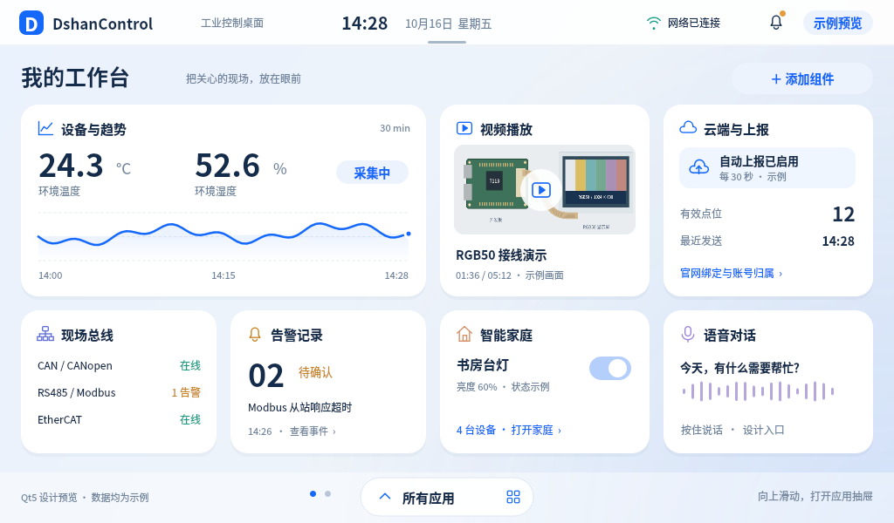
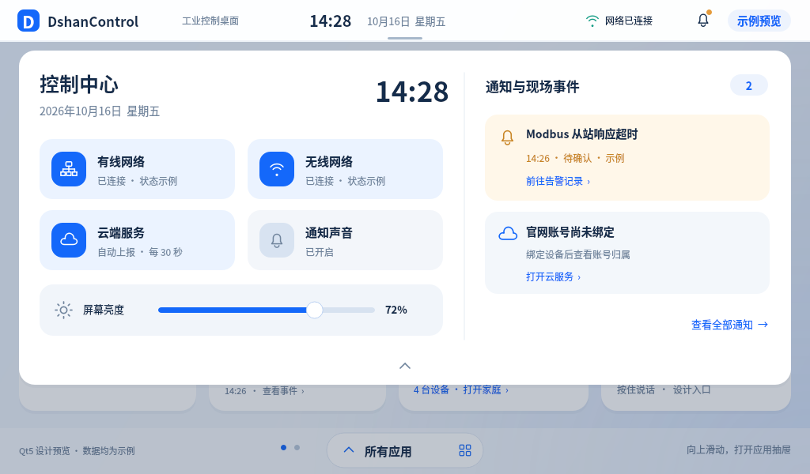
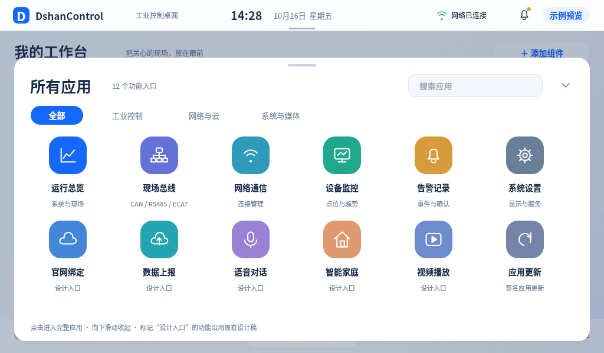
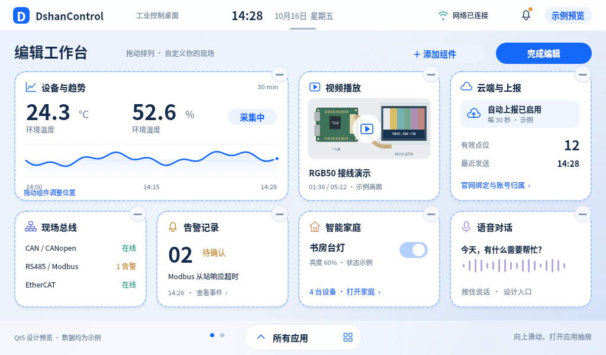
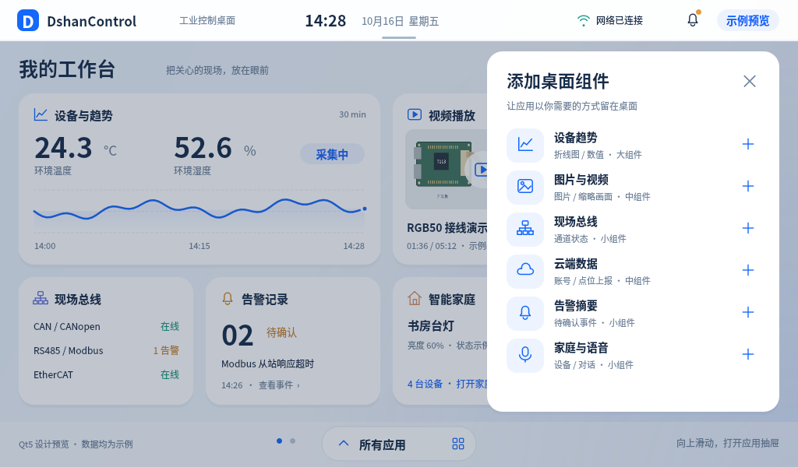
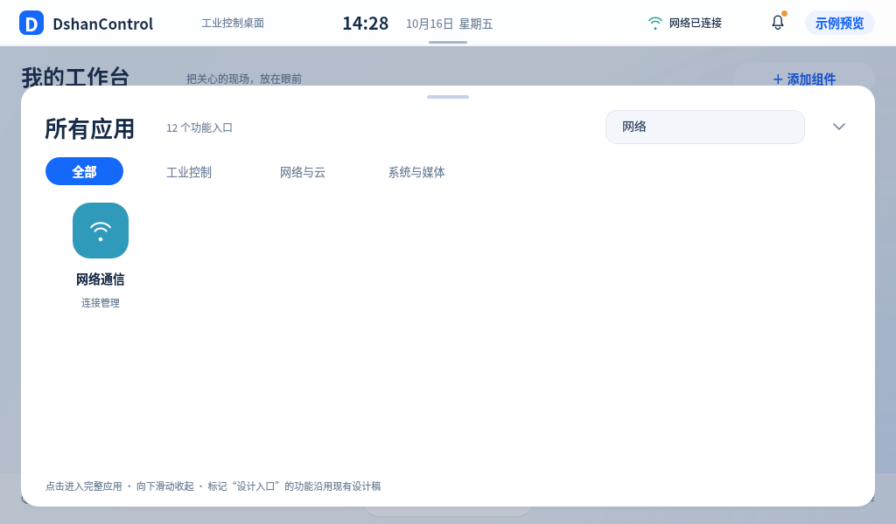
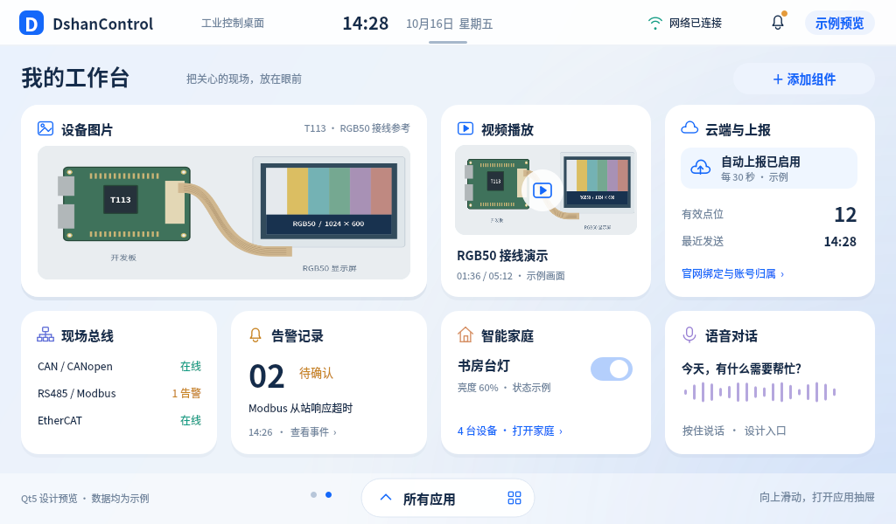
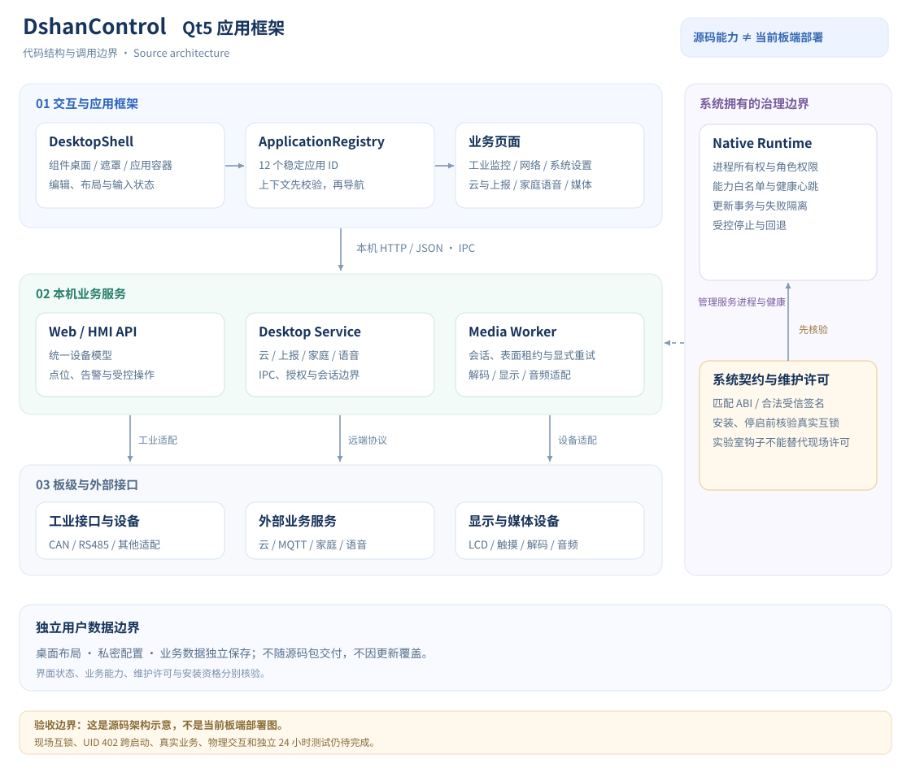

# DshanControl

**面向带屏工业网关与边缘设备的 Qt5 组件桌面和应用框架。**

把设备趋势、告警、媒体与业务入口放在同一个工作台，通过本机 API 和独立后台服务连接设备与外部业务。

> 当前为源码开发预览。24 页界面 DP 版本已完成开发试烧；后续网络服务修复尚未安装。详见[当前交付状态](docs/CURRENT-STATUS.md)。下方图片为历史框架主机示例，保留作为设计参考，不是当前板端截图。



## 工作台与应用框架

- **可配置工作台**：组件添加、编辑、删除与布局保存，组合设备趋势、图片、媒体、云、家庭和语音入口。
- **统一应用入口**：12 个稳定应用 ID，集中管理注册、分类、路由和上下文校验；无效参数在切页前拒绝。
- **桌面交互**：顶部控制中心、底部应用抽屉、中文搜索与拼音输入，应用容器支持进入、返回与遮罩状态。
- **后台与系统分层**：界面通过本机 API / IPC 获取能力，后台承担协议和业务边界，系统管理进程角色、健康、维护许可与更新事务。

本项目提供可扩展框架与业务界面；源码中的适配入口不等于现场设备、外部账号或硬件功能已经完成验收。

## 框架示例与页面记录

以下图片为既有框架发布的 Ubuntu / Qt5 固定示例。10 张批准图的零像素差异属于 [2026-10-22 的验证记录](docs/validation/2026-10-22-framework-source-validation.json)，不代表后续页面仍与这些图片一致。最新 24 页流程、功能变化与截图证据引用见 [DP 逐页交付记录](docs/design/page-gates/implementation-delivery-dp.md)。

<table>
  <tr>
    <td width="50%"><strong>顶部控制中心</strong><br><a href="docs/images/qt5-desktop/control-center.png"></a></td>
    <td width="50%"><strong>全部应用</strong><br><a href="docs/images/qt5-desktop/app-drawer.png"></a></td>
  </tr>
  <tr>
    <td><strong>编辑工作台</strong><br><a href="docs/images/qt5-desktop/widget-editor.png"></a></td>
    <td><strong>组件库</strong><br><a href="docs/images/qt5-desktop/widget-library.png"></a></td>
  </tr>
  <tr>
    <td><strong>应用搜索</strong><br><a href="docs/images/qt5-desktop/app-search.png"></a></td>
    <td><strong>图片组件</strong><br><a href="docs/images/qt5-desktop/image-widget.png"></a></td>
  </tr>
</table>

[展开组件](docs/images/qt5-desktop/expanded-widget.png) · [1280×720 宽屏示例](docs/images/qt5-desktop/wide-screen.png) · [原始批准设计与需求](docs/design/component-desktop-v1/README.md)

## 架构



应用通过 `DesktopShell → ApplicationRegistry → 业务页面` 进入。后台服务分别处理设备数据、云与家庭/语音业务、媒体会话；Native Runtime 管理进程生命周期、权限和更新事务。真实现场维护许可属于系统边界，不能由界面状态或实验室钩子替代。

布局、私密配置和业务数据独立保存，不进入公开源码包。架构图描述源码组织，**不表示当前板端已经部署全部角色和服务**。

- [应用注册、路由与扩展方法](components/hmi/src/desktop/README.md)
- [架构与调用边界说明](docs/architecture/README.md)
- [完整源码预览与验证范围](PREVIEW.md)

## 主机开发

当前适配目标为 **T113s4 SD NAND / Linux / Qt5.11.3**；目标板资格仍待完成。主机开发与本次验证使用 Ubuntu / Qt5.12.8；目标 SDK、Cedar 和 Qt 私有 ABI 组件须保持匹配。

主机需要 C++ 工具链、Qt5 Core/Gui/Widgets/Network/Test 与 qmake，以及 OpenSSL、zlib、SQLite 开发包和 Python3 venv。私有 TLS/MQTT 回归另需 Mosquitto 及客户端工具。

```sh
git clone --branch fix/qt-application-workflows-20261028 https://github.com/dshanpi/DshanControl.git
cd DshanControl
make test-bootstrap
make test HMI_QMAKE=/usr/bin/qmake
make test-hmi HMI_QMAKE=/usr/bin/qmake
```

构建并生成独立示例图片：

```sh
mkdir -p dist/hmi
cd dist/hmi
/usr/bin/qmake ../../components/hmi/src/omnigate-hmi.pro
make
QT_QPA_PLATFORM=offscreen ./omnigate-hmi --desktop-render ../desktop-render
```

主机窗口预览使用 `./omnigate-hmi --windowed`。实时界面需要本机 Web API 和后台 IPC；后台不可用时保留不可用状态，不回填示例数据。固定渲染用于视觉回归，不会连接真实业务。

## 代码导航

|目录|职责|
|---|---|
|`components/hmi/src/desktop/`|工作台、应用注册、组件编辑、抽屉、布局、图片与输入|
|`components/hmi/src/`|设备、总线、网络、告警、云、家庭/语音、媒体及更新界面|
|`components/desktop/`|本机 IPC 与云、上报、家庭、语音服务边界|
|`components/runtime/`|原生进程、角色权限、健康、更新事务和回退|
|`components/media/`|媒体工作进程、表面租约及目标解码/显示适配|
|`components/core/`、`components/web/`|统一模型、业务 API 与 Web 服务|
|`boards/t113s4-sdnand/`|目标系统集成、配置与契约|
|`tests/`、`scripts/`|主机回归、构建、源码与目标包校验|
|`docs/design/component-desktop-v1/`|批准设计、交互合同和原始验收要求|
|`docs/design/page-gates/`|24 页流程、功能变更、源码绑定与逐次交付历史|
|`docs/validation/`|按日期保留的验证范围、跳过项与未完成项|

阅读入口：[当前交付状态](docs/CURRENT-STATUS.md) · [逐页交付门禁](docs/design/page-delivery-gate.md) · [S4 系统集成](boards/t113s4-sdnand/README.md)。

## 验证与当前状态

|检查|最近记录|范围|
|---|---|---|
|核心与仓库主机回归|DQ：核心 5 项通过；仓库 394 项，383 通过、11 项权限环境跳过、0 失败|2026-10-31 主机验证|
|Qt 界面回归|DP：121 主回归 + 6 隔离 + 15 上报页面 + 7 注册器用例；无失败、无跳过|DQ 未改 HMI，未重复该矩阵|
|网络服务兼容修复|旧程序 4 项失败，新候选 4 项通过|分别在主机和 ARM 用户态仿真中复现；尚未上板|
|DS 网络服务启停|26 项主机检查与 8 项目标 shell 仿真检查通过|失败状态、真实启停与端口释放；尚未上板|
|DP 完整系统|烧写、校验、启动身份与帧缓冲核验通过|开发试验；物理 LCD 与本版手指导航尚未确认|
|历史框架检查|[2026-10-22 主机记录](docs/validation/2026-10-22-framework-source-validation.json)及[历史 CI](https://github.com/dshanpi/DshanControl/actions/runs/39793430696)|不作为当前工作分支 CI 结论|
|原始需求验收|**25 PASS / 48 PARTIAL / 0 RUNNING**|共 73 项，仍未全部完成|

Qt 用例数量不等于需求验收数量。[当前交付状态](docs/CURRENT-STATUS.md)集中列出各次验证的源码范围；[73 项记录](docs/validation/component-desktop-preview-acceptance.csv)保留原始验收进度。

仍待完成真实云/家庭/语音/现场总线、物理 LCD/触摸/音频、完整媒体资源回收、原生角色跨启动、持久安装与回退，以及独立真实 86400 秒测试。历史中断时段不能合并为 24 小时通过；当前没有已确认运行的独立长测。

## 源码交付与板端安装

`make package RELEASE_DIR=dist/source-preview` 只从干净、已提交的 Git 树导出源码，生成 SHA256 与源提交说明。未跟踪文件不进入归档；存在未提交改动或同名输出时拒绝导出。

**源码包不是可安装应用包或系统固件。** 源码推送、合并和发布不会让板端自动变成新版 UI。DP 版本（965087a）已正式烧入开发试验镜像并核验启动；DQ 二进制兼容修复与 DS 启停脚本修复均已验证各自记录中的离线范围，尚未安装。

现场仍连接设备时，部署前必须取得真实、适用的维护互锁许可，并满足系统契约、目标 ABI、受信签名、健康与保数据回退门禁。当前互锁尚未接入，不能用实验室脚本、空回调或开发标志绕过。[正式发布规则](docs/RELEASING.md)

## 许可与资料

项目许可见 [LICENSE](LICENSE)，第三方来源与许可见 [THIRD_PARTY.md](THIRD_PARTY.md) 及各组件目录。源码交付不包含设备密钥、用户数据、私密配置、私有 SDK 或厂商预编译库。

历史系统交付和实板证据保留在 `docs/` 中；以各记录的日期、提交和验证范围为准，最新入口见[当前交付状态](docs/CURRENT-STATUS.md)。
