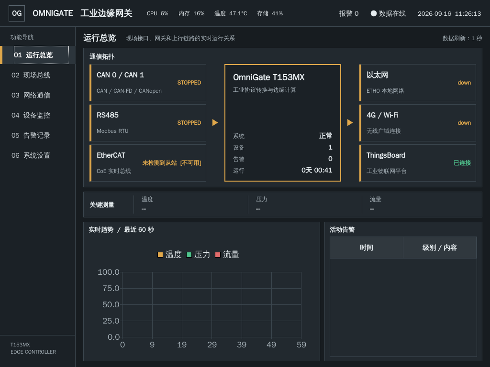
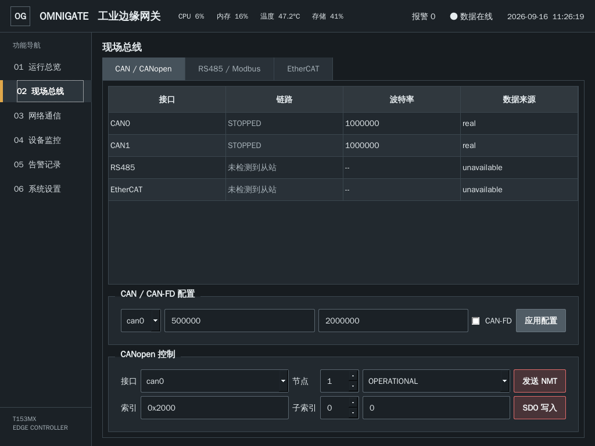
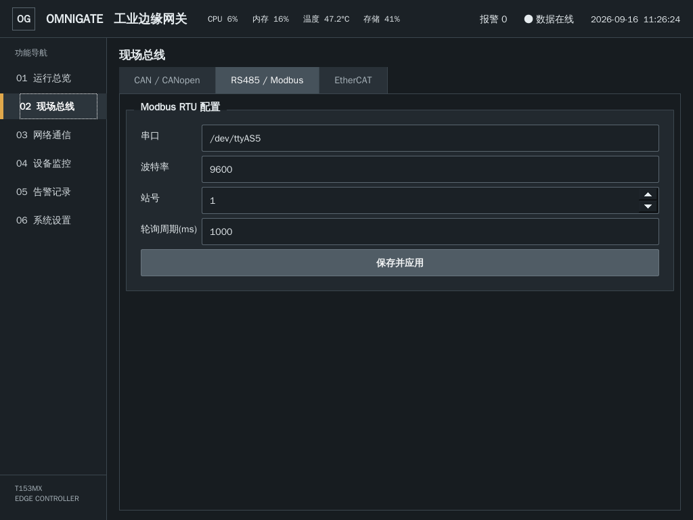
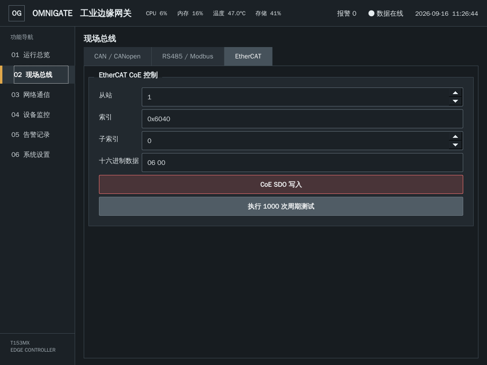
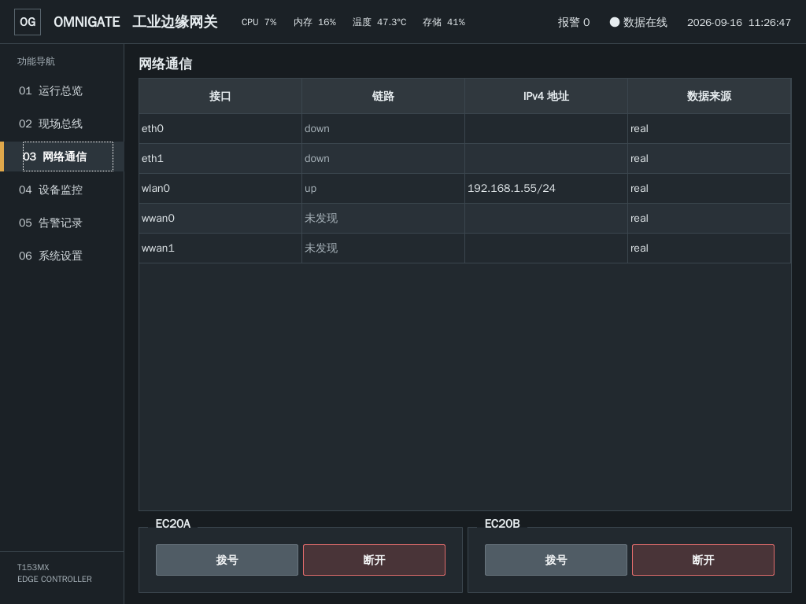
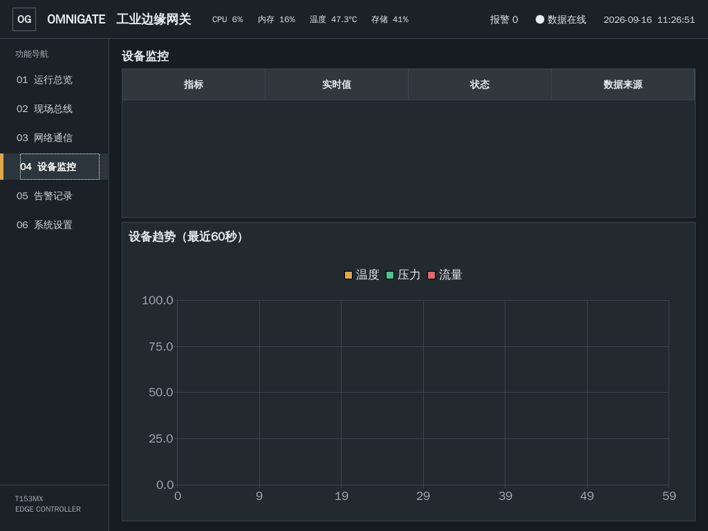
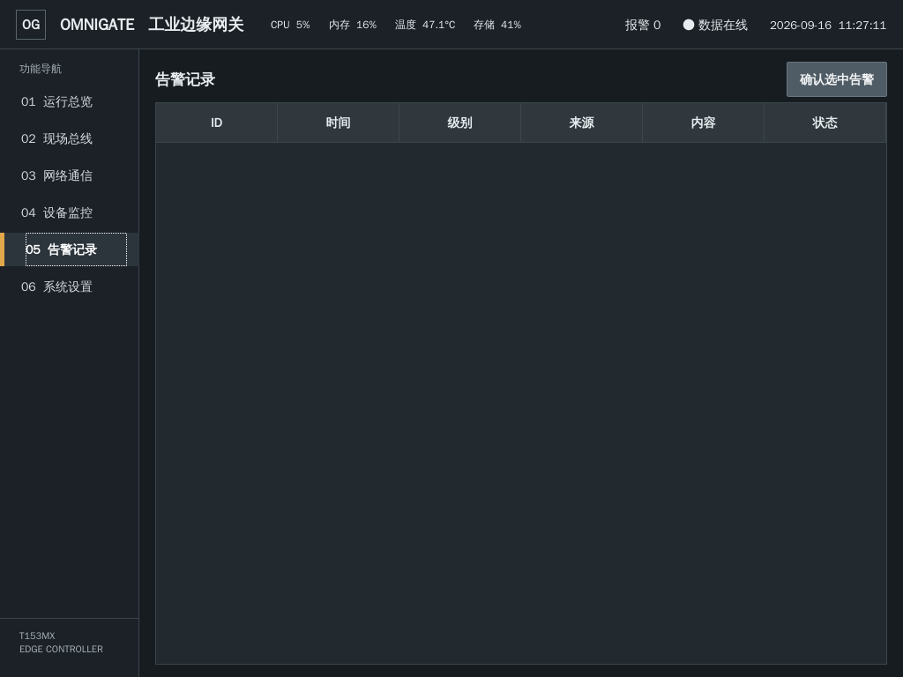
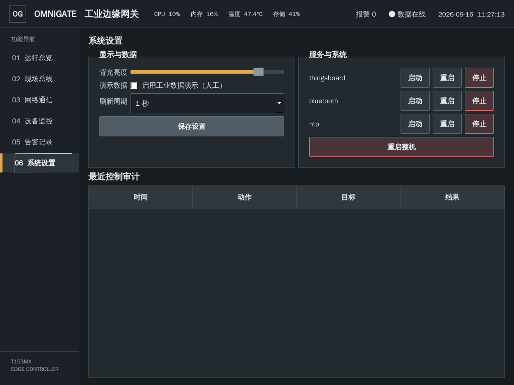
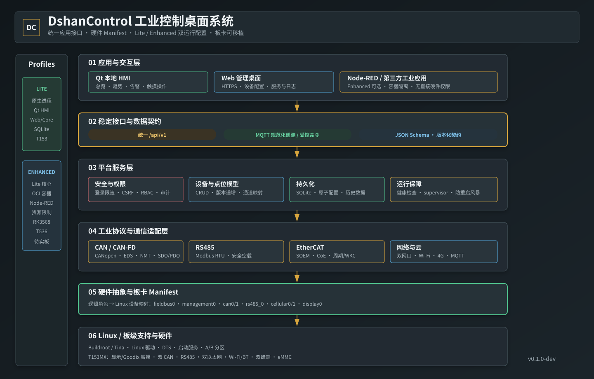

> **Qt5组件桌面测试版**：本分支尚未全部验收。请先阅读 [版本说明与未验收项](PREVIEW.md) 和 [一比一设计需求包](docs/design/component-desktop-v1/README.md)。

6ULL Pro 开发分支：[`boards/imx6ull-pro`](boards/imx6ull-pro/README.md)，基于 Qt5
组件桌面预览，包含 Buildroot、7 寸 RGB LCD、Wi-Fi 和本地软件视频接入。
[实板验收及发布限制](docs/IMX6ULL-DEVELOPMENT-20261022.md)；仍为开发候选，未取得生产 OTA 资格。


# DshanControl

## T113s4 SD NAND 开发交付

[压缩镜像与 SDK 差异草稿附件](https://github.com/dshanpi/DshanControl/releases/tag/untagged-ec6ef64420bc69140037)
（需有仓库权限的 GitHub 账号登录）；另见
[版本配对与使用说明](docs/S4-SYSTEM-DELIVERY-20261014.md) 和
[18 项远端附件回下载校验记录](docs/validation/2026-10-14-system-delivery.json)。
目标是 Tina 厂商系统、Buildroot、RGB50/GT911、AIC8800D80。
这是包含空 ext4 UDISK 的工厂整机镜像，烧录会覆盖现有应用与用户数据，须先备份。
脱敏副本未重新实板烧录，不包含板上后续第 6 版 C++ 试验层；正式 OTA 尚未验收。

## T153MX 历史实板桌面

以下界面均由运行 Linux `#69` 的 T153MX 通过 `fbgrab` 从真实 framebuffer 获取，
不是设计稿或模拟器截图。采集信息、逐图校验值和测试边界见
[实板 UI 记录](docs/t153mx-board-ui.md)。
这是历史深灰界面的实板证据，不代表当前蓝白界面已经上板验收。

<table>
  <tr>
    <td><strong>运行总览</strong><br></td>
    <td><strong>CAN / CANopen</strong><br></td>
  </tr>
  <tr>
    <td><strong>RS485 / Modbus</strong><br></td>
    <td><strong>EtherCAT</strong><br></td>
  </tr>
  <tr>
    <td><strong>网络通信</strong><br></td>
    <td><strong>设备监控</strong><br></td>
  </tr>
  <tr>
    <td><strong>告警记录</strong><br></td>
    <td><strong>系统设置</strong><br></td>
  </tr>
</table>

DshanControl 是一个面向工业网关、边缘控制器和带屏设备的开源工业控制桌面系统。
它提供统一设备模型、Qt 本地 HMI、Web 管理、服务自愈、工业协议适配契约，以及
Lite/Enhanced 两类运行配置。

当前版本为 `0.1.0-dev`，已经在 Allwinner T153 开发板完成短时软件验收，但不是
IEC 62443 认证产品，也不能替代具体现场总线从站的互操作测试。

## 主要能力

- 统一 `/api/v1`：平台、通道、系统状态、设备、点位和审计。
- Qt/C++ 蓝白工业 HMI：以 RGB50 1024×600 为基准，按屏幕重排；保留 T153
  1024×768 布局。本机验证见 [UI 实现记录](docs/UI-IMPLEMENTATION.md)，当前界面实板验收待完成。
- Web 管理：认证、CSRF、角色、登录限速、安全响应头和可选 HTTPS。
- CAN/CAN-FD、CANopen、Modbus RTU、SOEM EtherCAT 和蜂窝适配接口。
- SQLite 持久化、配置原子写入、健康检查和有限重启 supervisor。
- Enhanced Node-RED 4.1.7 配置：登录保护、持久卷、资源限制且无硬件设备权限。
- 机器可读的运行 profile、板卡描述、硬件 Manifest 和 MQTT 数据 Schema。

## 目录

```text
components/       core、HMI、Web、supervisor 等可复用组件
platform/         profiles、boards、contracts、schemas 和 Node-RED 配置
deploy/           板卡运行时 Manifest 与开源服务接入示例
boards/           T153MX 等板卡的源码接入层、配置与验收工具
docs/             架构、移植、安全和发布说明
scripts/          测试与源码发布工具
tests/            平台与 Web 自动化测试
```

应用必须通过 `/etc/omnigate/platform.json` 解析逻辑通道，不得写死 `can0`、
`eth0` 或 `/dev/tty*`。完整架构见 [platform/docs/architecture.md](platform/docs/architecture.md)，
新板卡移植见 [platform/docs/porting-guide.md](platform/docs/porting-guide.md)。

T153MX Tina Linux 5 的 DTS、内核/Buildroot 配置、A/B 分区、rootfs 服务、
协议包配方和实板验收脚本已备份到
[boards/t153mx-tina5](boards/t153mx-tina5/README.md)。该目录是源码级板卡接入快照，
不包含厂商二进制、完整 SDK 或可直接烧写的固件镜像。

## 测试

```sh
make test-bootstrap
make test
```

## 发布边界

本仓库仅包含可复用的 GPL-3.0 开源平台源码和板卡接入示例。Allwinner BSP、无线固件、
厂商烧录工具和完整 T153 SDK 不属于本仓库。详见
[docs/open-source-release.md](docs/open-source-release.md)。

## 状态

- T153 Lite：短时实板软件测试通过；Goodix GT911 已在 `0x14` 注册为
  `/dev/input/event1`。五点物理触控准确性仍待人工确认。
- Enhanced：Node-RED 主机配置测试通过；RK3568/T536 实板测试未完成。
- 24 小时老化、生产安全基线、签名 OTA 和自动回滚尚未完成。

许可证：[GPL-3.0](LICENSE)。

## 系统架构



可编辑 Mermaid 源图和分层说明见
[docs/system-architecture.md](docs/system-architecture.md)。

## T113s4 SD NAND 接入与应用更新（开发中）

DshanControl 延续已有 T153 工业桌面实现，新增以
[100ASK_T113s4-SdNand_TinaSDK5](https://github.com/DongshanPI/100ASK_T113s4-SdNand_TinaSDK5)
为底层来源的 Buildroot 201902 接入。EinkOS 仅提供分层与发布标准参考；
SmartDesktopMimi 是独立项目。

[S4 接入说明](boards/t113s4-sdnand/README.md) 包含隔离构建、运行目录及验收限制。
[应用更新说明](components/updater/README.md) 描述签名清单、GitHub 检查、事务安装和恢复。
[发布门禁](docs/RELEASING.md) 区分系统镜像与应用升级包；原源码打包命令不是应用升级包。
S4 已有启动、触摸及应用升级开发试验；正式基线、工业互操作和完整更新链路尚未验收，不提供生产 OTA 声明。

T113s3 与 S4 的名称关系仍待实板身份确认，不据此更改 BSP。
A133、T527、RK3576、IMX6ULL-PRO、STM32MP157、RK3506 是未来适配目标，
须分别提供板级适配与实测产物，当前不声明支持，见 [主板适配队列](docs/BOARD-PORTING-QUEUE.md)。

## C++ 更新框架进展

原生更新核心、独立任务服务和亮度平台接口使用 C++11/Qt，见
[原生运行端](components/runtime/README.md)。桌面已接通原生检查、下载、确认安装
和任务错误显示；旧系统需先完成原生服务及信任根集成，不能只打开界面开关。
其他硬件操作及旧 Web 运行栈仍在迁移，完整实板自动升级尚未验收。
当前状态、历史实板证据和本机验证见 [验收记录](docs/ITERATION-ACCEPTANCE.md)，
系统/应用双发布线和防错板门禁见 [落实方案](docs/APPLICATION-UPDATE-PLAN.md)。
代码提交后本机测试及 S4 交叉构建结果见
[2026-10-14 验证记录](docs/validation/2026-10-14-native-updates.json)。远端 CI 已补充
Qt/OpenSSL/zlib 构建依赖及 Qt UI 验证步骤，使用本机已有 GitHub SSH 登录推送；
实际运行结果见验收记录，不能用本机通过替代远端结果。
最新代码远端 CI 已通过，主机测试共 153 项，Qt 测试 35 项。
[历史 CI 记录](docs/validation/2026-10-14-ci.json) 和
[首轮实板记录](docs/validation/2026-10-14-board-native-ota.json)、
[继续验证记录](docs/validation/2026-10-14-board-native-ota-continuation.json) 保留对应源码与证据。
实板已完成完整签名应用包安装、健康原码/失败回退、prepared 和 switched 两处真实断电恢复，
以及真实 Qt 检查按钮调用、终态显示修正、冷启动自动连接 WiFi 和亮度服务就绪检查；
当前运行独立开发试验目录，采用 fixture 契约、用户数据副本和临时系统启动层。
正式硬件版本匹配、GitHub 下载安装闭环及完整实板 OTA 仍待验收。
