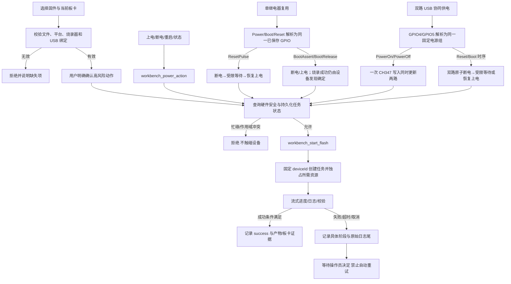
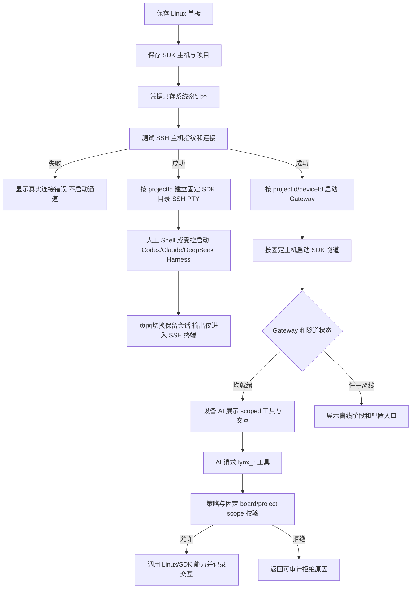
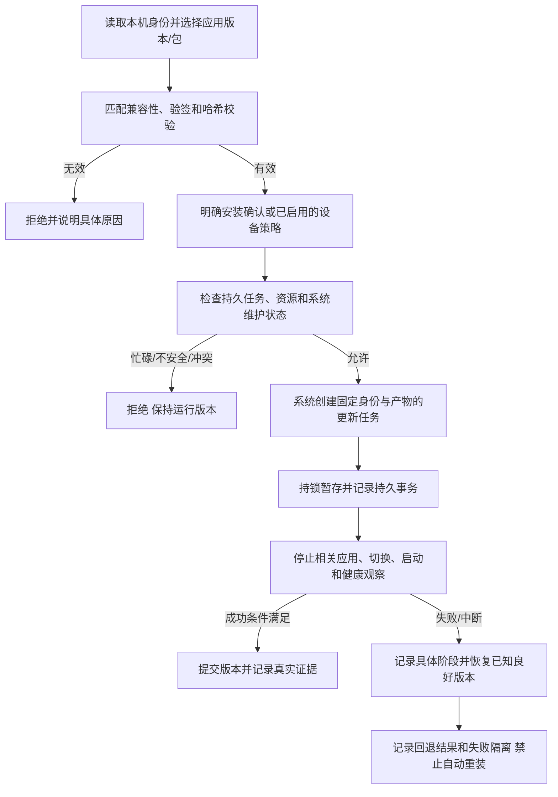

# DshanControl 硬件操作与应用更新门禁

记录日期：2026-10-14。来源：用户确认的分层更新方案及本会话提供的 BL-04/BL-05 需求。
本文是持续有效的审查和验收约束，记录入库不等于相应功能已实现或验收。

## 适用范围与职责

用户已确认 `APPLICATION-UPDATE-PLAN.md` 中的方向：DshanControl 独立开发和发布应用；
系统平台服务、更新器、信任根及各板 BSP 作为稳定底座；应用与系统分别发布。
EinkOS 提供标准参考，各目标仍需自己的构建和真实验收证据。

下列原始 `REQ-UI-*`、`REQ-HW-*`、`REQ-SSH-*`、`REQ-LINUX-*` 属于
LYNX/Workbench 的界面、控制器或 Gateway 需求，在本仓库作为外部集成门禁保留。
`workbench_start_flash`、`workbench_power_action`、`LocalFlashOptions`、
`DeviceAiChannel` 是对应组件的接口名称，不表示本仓库已实现或当前 MCP 已暴露这些接口。
实际工具调用须遵循已连接服务返回的 schema，不得另造参数或绕过 adapter。
涉及外部实现的验收需要该组件的版本、代码/日志证据；本仓库文档不能代替其验收。

DshanControl 自身的应用更新约束使用独立 `REQ-APP-UPDATE-*` 编号，见后文。
既有授权在相同目标、产物、操作和作用域内继续有效；本文件不要求对同一已授权动作
重复确认。路径恢复、扫描、状态查询及其他只读操作不产生烧录/供电授权。

## BL-04：烧录呈现、执行与失败边

| 需求 | 必须保留的约束 |
| --- | --- |
| REQ-UI-319 | A 按 deviceId/系统类型恢复本地镜像路径；主线模式直接选择 FES Loader 与枚举存储路线。恢复仅触发文件检查。B 校验非空 Loader、平台与路线；G 仅通过类型化 LocalFlashOptions 映射已有 NAND/eMMC 参数。D/E 人工确认、任务/资源门禁、固定绑定及 I～L 执行/失败边不变。 |
| REQ-HW-027 | H→I 的 FES MBR 最终状态响应采用独立有界等待，记录具体阶段和耗时；错误保留原码，I→K 不得被通用 verify failed 覆盖。失败不自动重发；分区布局和保存的设备绑定不变。 |
| REQ-UI-318 | A 左侧纵排固件/系统选项，右侧任务和主操作，底部日志；已绑定 USB/串口字段并排。I/J/K 保留可导出的原始烧录日志，显示使用已有可读转换；区分历史任务与新任务准备状态。B～L 业务边不变。 |
| REQ-UI-317 | A 提供离线与 AI MCP 两个呈现入口。离线入口并排选文件/系统类型，设备仅来自当前 saved board；有限选项通过已有 adapter 和 G 提交，主线使用已保存 Loader/介质路线。AI 复用 BL-05 DeviceAiChannel 和任务遥测。B～L 审批、资源锁、错误及禁止自动重试不变；元数据读取不得冒充固件完整性校验。 |
| REQ-UI-307 | 页头电源圆形按钮沿 M→N 调用 workbench_power_action；write-only 状态只投影最后一次成功控制事实并明确标注。烧录状态仅来自相同 deviceId/taskId 的 running/success/failed；点击、USB 在线、串口或 ADB 状态不构成成功证据。门禁、审计、失败不重试和终态不变。 |
| REQ-UI-305（部分记录） | 已提供部分只确认：不改变 BL-04 烧录执行边，只修复 I→K 的只读投影。用户原文在“实时遥测与持久化”处截断，后面的 channels/configs/devices.filter 行号片段缺少完整上下文。未提供的业务规则与验收条件待补齐，不据此推导执行改动或标记通过。 |

此处“主线模式”的 Loader/路线仅适用于明确选择并获支持的该系统类型。
本次 T113s4 开发烧录仍遵循已授权的厂商 Tina IMAGEWTY 包和固定板型；不得因记录
REQ-UI-319 就切换到主线镜像、替换分区表或推断 SD NAND 的烧录参数。

硬件安全与资源门禁必须包住每次实际写入，图中的回流不得解释为写完设备才做检查。
任务固定 deviceId，保存的 USB/串口/电源绑定为唯一来源；发现在线设备不能静默改绑。
success 需要真实任务的成功条件和校验；系统能否启动须另有启动证据。

### 供电模式不变量

- 单继电器复用：Power/Boot/Reset 解析为同一已保存 GPIO，ResetPulse 是断电、
  受限等待、恢复上电；BootAssert/BootRelease 是该配置下的断电/上电，
  不得把电源动作本身当成 FEL/FES 发现成功。
- 双路 USB 协同供电：第二 GPIO 是辅助供电轨，不提供独立 Boot 引脚语义。
  GPIO4/GPIO5 按该模式解析为同一固定电源组；所有板卡电源入口必须与主供电
  在同一次 CH347 GPIO 写入中更新。Reset/Boot 时序同样按双路原子更新执行。
- 任一路配置缺失、重复、越界或写入失败均拒绝继续，不自动重试，不把部分上电
  记为成功；write-only 控制器不得把命令成功投影成物理电平读回。
- 这些规则不证明当前 S4 已接 CH347 双路供电。只有实际保存的控制器和模式
  匹配时才使用相应路线；不能把参考 GPIO 当成新板的默认接线。

## BL-05：Linux SDK、SSH PTY、Gateway、隧道与设备 AI

REQ-SSH-TRUST-001：D 握手发现未知/变化密钥，显示固定目标与新旧指纹。
人工拒绝则结束；人工确认后再次握手，验证实际密钥等于所确认密钥，再认证，
保存 host 指纹及连接测试的审计关联。G、远端健康检查、下载、终端、构建采用
同一严格校验；密钥错误进入可见阻断态，显式保存通道后重新连接。
保留共享主机、凭据库、固定 scope 以及硬件失败不自动重试规则。

### 通道、日志和秘密边界

- SSH、UART、ADB、烧录输出独立；SSH PTY 仅允许相同 project/device 作用域写入。
  页面切换保留会话；断线后不得静默重放输入或把命令发给另一目标。
- API Key、SSH 密码、私钥、终端输入/输出正文不得进入普通配置、日志或审计。
  审计记录作用域、操作、阶段、时间、结果和脱敏错误，不复制终端正文。
  原始烧录任务日志的受控留存/导出与 SSH 终端正文分开；显示转换不能覆盖原始证据，
  导出和展示也不能泄露凭据。密钥库要求适用于对应 LYNX 凭据组件，
  不得把现有私有实验 WiFi 文件误标成已接入系统密钥环。
- Gateway 与隧道都就绪才展示可用 AI 工具；任一离线显示真实阻断阶段和配置入口。
  Linux Gateway 不接 MCU 工具；Linux 工具也不能出现在 MCU MCP。
- DeepSeek Harness 仅使用当前 SDK 通道生成的临时 Cordis patch，退出清理；
  不改用户级 `~/.dsh`、SDK 目录或其他 profile，不把动态 MCP URL 扩大为任意调用方目标。
- REQ-LINUX-018：`lynx_camera_capture` 只解析当前保存 deviceId 的固定摄像头绑定，
  调用方不能传设备路径/输出路径；返回受限 JPEG MCP image，失败释放摄像头且
  不换用其他设备。工具仅属于 Linux Gateway；当前 DshanControl 摄像头支持不得据此推定。
- 保留本项目已有传输约定：文件载荷走网络，UART 只承载命令和诊断；
  厂商烧录通过 USB FEL/FES。SSH 主机密钥变化不能靠关闭校验继续下载。

## DshanControl 应用更新：对应的执行门禁

以下是确认后的产品约束。现有更新器可复用，尚缺的系统任务/UI/平台服务能力按
`APPLICATION-UPDATE-PLAN.md` 实施；不能仅写入本文就把验收状态改为 passed。

| 需求 | 要求及验收边界 |
| --- | --- |
| REQ-APP-UPDATE-001 分层和双发布线 | application 只包含应用及允许的私有资源；平台服务/底层/更新器/信任根走 system。纯应用不强制重建 SDK、镜像或新增硬件提交。 |
| REQ-APP-UPDATE-002 配对和来源 | 应用完整提交、源码/实际二进制/包/构建记录对应；产品、板型/硬件修订、ISA/浮点 ABI、libc、runtime、系统契约、更新器、渠道、升级来源和数据格式逐项匹配。未知值或错配在停应用前拒绝。保持系统锁中的出厂 A0 与当前 A1 分开。 |
| REQ-APP-UPDATE-003 入口和只读恢复 | GitHub 与离线应用包入口进入同一验证与安装流程。路径/版本恢复仅检查文件，读取元数据不算验签或完整性通过；应用入口拒绝系统固件和其他产品资产。 |
| REQ-APP-UPDATE-004 安装授权与维护 | 自动检查/下载不等于安装授权；人工安装明确确认目标与版本，自动安装依设备显式策略。安装必须取得系统维护互锁并保持到切换/回退结束，活跃控制或作用域冲突时拒绝且不停止服务。 |
| REQ-APP-UPDATE-005 固定任务和边界 | 系统拥有的更新任务固定设备身份、任务 ID、清单/签名/包哈希及兼容目标；独占所需存储/生命周期资源。前端只传有限类型化请求，系统再次校验；当前 CLI 仍按已有参数工作，不把拟议任务接口冒充已实现。 |
| REQ-APP-UPDATE-006 独立执行与投影 | 安装任务独立于将被停止的 HMI；检查、下载、验证、等待维护、暂存、切换、健康、回退分别展示。准备态与历史终态分开，实时和持久状态仅投影同一设备/任务，不由按钮或网络连接推断成功。 |
| REQ-APP-UPDATE-007 阶段和原始错误 | 网络、签名、空间、维护、停服务、切换、健康与回退使用适用的有界等待；保留具体阶段、耗时、原始错误码及脱敏详情。不可用“更新失败/校验失败”覆盖真正的故障。 |
| REQ-APP-UPDATE-008 恢复与禁止重装 | 失败、超时、取消记录确定结果，等待操作者处置或后续明确策略，不自动重新安装同一失败版本；不自动改绑设备或放宽兼容性。既有持久事务恢复和本机已知良好版本自动回退继续执行，它们不等于重新发送失败升级。 |
| REQ-APP-UPDATE-009 成功和数据 | 同一任务在应用身份、HMI 功能心跳、平台 IPC、数据库与必要能力通过健康观察后才成功。用户数据独立，v1 拒绝 schema 变化；序号防重放、失败隔离、旧版恢复与数据一致。 |
| REQ-APP-UPDATE-010 发布证据 | 每目标固定系统镜像/契约、包、日志哈希及测试者/时间；错板/篡改/资源冲突/实板掉电/回退/数据保护验收。远端标签与实际附件复核后晋级，公开后不可变；缺证据保留草稿。 |

这张图约束现有 C++ 独立任务接口与 CLI 事务/恢复；实现及实测范围见实板记录。
应用更新不调用烧录/供电入口，不写块设备、不自动重启到 FEL、不改分区或 USB 绑定。
需要系统变更时明确转入 system/LYNX 流程，不在应用升级失败后自动“改用烧录修复”。

## 证据与后续审查

原始 REQ 标识与上述流程边作为审查索引，不重新解释为全部已完成。
验收需提供组件版本、固定作用域、输入产物哈希、阶段/耗时、错误码、真实任务结果，
并覆盖取消、资源冲突、错误目标、缺失绑定和失败不重试。
门禁最初入库时的 41 项主机测试属于历史软件证据，并未改造 LYNX。
后续已有 C++ 实现、153 项主机/35 项 Qt 测试及开发实板证据，见
[实板继续验证](validation/2026-10-14-board-native-ota-continuation.json)。
prepared/switched 两处物理断电、真实 Qt 检查和临时系统启动层均只证明相应开发范围；
不改变外部 BL-04/BL-05 的审批/资源/信任/失败边，也不满足全部生产发布门禁。
