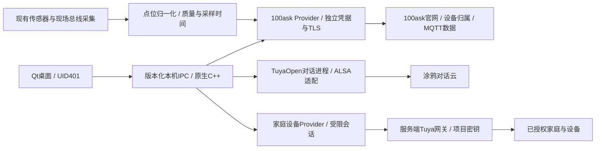
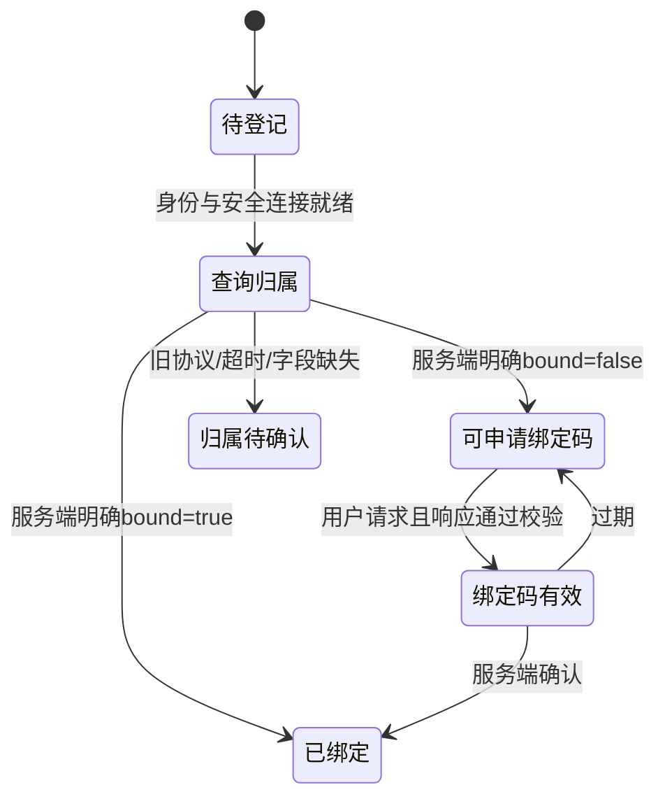

# 官网、传感器上报与涂鸦接入设计

本轮目标：从 `/home/ubuntu/AI-DeskTopBox` 提取可复用代码，设计其接入当前
DshanControl Qt 桌面的界面与服务边界。先交可运行的 Qt 评审原型；本轮不改变
板端服务、账号绑定、可信密钥或现有桌面。设计里的账号、设备和读数均为样例。

## 本轮要求

| 编号 | 要求 | 本轮产物 |
| --- | --- | --- |
| REQ-CLOUD-001 | 官网设备身份、用户配对与 MQTT 自动上报 | 来源锁、配对/上报页面、接入流程 |
| REQ-TUYA-001 | 涂鸦语音对话与本机状态 | 运行时桥来源、独立语音页与状态约定 |
| REQ-HOME-001 | 查看并控制已授权家庭设备 | 家庭设备/未授权/待回执原型、网关接口 |
| REQ-UI-001 | 延续蓝白 Qt 桌面，不做通用聊天产品模板 | 实际 Qt 控件、1024×600 主图、触控与空态 |

## 设计方向

延续当前桌面的白色工作面、浅蓝导航和清楚的表格。主色 #0062FF，背景
#F2F7FD，导航 #E8F3FF，正文 #092650，分隔线 #D9E3EF，确认色 #168366。
沿用内置 Dshan Sans，正文 14–16px，标题 25px，触控动作至少44px。

保留现有六个主入口，增加“云服务”和“家庭与对话”。云服务分“官网绑定 /
数据上报”；家庭与对话分“语音对话 / 家庭设备”。少量操作用右侧详情和底部
操作栏表达，避免满屏相同卡片。语音页用清楚的转写记录、说话按钮和设备状态。
房间设备用列表和真实能力控件，不增加装饰性光球、持续动效或营销标语。

```
40px  品牌 / 桌面状态
140px 导航 | 页面标题
           | 官网绑定 [数据上报]   或   语音对话 [家庭设备]
           | 主工作区                         | 详情 / 操作
28px  原型标记与示例状态
```

方案复核：保留现有字体、导航和图标；用绑定码、点位表、对话记录、家庭列表四种
不同的信息结构对应实际任务。没有另加宣传首页、数字统计墙或另一套品牌色。
在800px宽度保持文字与44px操作区域，用局部滚动承载内容，不缩放整张界面。

## 代码来源与边界

本地提取包：`dist/cloud-home-design-20261016/source-import/`；逐文件来源、实际内容
SHA256、工作树是否修改均记录在同目录的 `source-import-lock.json`。来源工作树有
大量未提交修改，不能把仓库HEAD当作所有文件内容身份。另提取了其受控公共快照的
IoT客户端/配对状态头，以及私有接入快照的配对解析和授权读取代码，分目录保留。

原项目公开/私有分离要求继续保留：本地参考包位于忽略提交的目录；不导入设备
`secret`、`device_sig`、`license.env`、`tuya_config.h`、私钥、厂商预编译库和私有
100ask SDK。原许可保留。Qt原型不读取实际凭据、不连接云、不自动注册/重置设备。

| 能力 | 已找到的实现 | 迁移方式 |
| --- | --- | --- |
| 官网身份与连接 | `service_cloud.c`、`service_cloud_validation.*` | 拆出100ask Provider，替换A133路径和LVGL消息总线 |
| 正确的配对归属 | 受控快照 `cloud_pairing_status.h`、私有 `pairing_response.h` | 保留已绑定/未绑定/未知三态与真实有效期；不照搬旧工作树的一小时常量 |
| 传感器自动上报 | `service_sensor.*`、`on_sensor()` | 保留有效样本过滤和30秒节流；数据源改为当前采集服务，传感器型号按实际硬件接入 |
| 涂鸦对话 | `service_ai_runtime.c`、TuyaOpen `app_chat_bot.*`/`tuya_main.c` | 保留独立进程和语音事件桥，UI改Qt；重新编译S4音频适配 |
| 家庭设备 | 受控公共快照 `iot_client.*`、`iot_json.h`、`iot_app.c` | 复用设备/能力/指令受理语义，重写Qt视图，受限凭据放后台 |
| 本机涂鸦DP | 14项DP Schema、Tuya事件处理 | 逐项与S4能力求交集；不迁移未确认的HDMI/灯带/电压传感器 |

A133预编译音频库、LVGL界面和A/B系统升级逻辑不搬到S4。云端更新通知只进入
当前已经存在的签名更新器，不执行云消息中任意URL、命令或另一套系统刷写程序。

## 集成架构



官网连接、官网账号归属、涂鸦本机激活、家庭账号授权分别存状态，不能互相推断。
Qt不持有设备secret、AuthKey、Tuya项目Access Secret或服务器签名密钥。受控操作由
本机服务验证会话、归属、设备能力和用户意图；语音内容不直接获得工业控制权限。
后续扩展现有Unix peer方法白名单：只读状态可给Web/HMI，取绑定码和家庭控制只给
明确获准的HMI操作；不能仅因为请求来自localhost就授予敏感能力。

## 官网绑定

设备身份来自已登记硬件身份；复用有效凭据连接，缺少身份显示“待设备登记”。
申请配对码必须由用户操作触发。已绑定只显示归属状态与“重新查询”，不能因为
没有绑定码而清身份、解绑或重新provision。旧服务器不返回归属字段时显示“待确认”。
设备登记后的连云、归属查询及数据上报可以自动完成；账号归属由官网已存在的
预绑定授权或用户确认决定，不根据设备在线就自动归到任意账号。
最新受控协议返回 `success/data/deviceId/bound/bindToken/bindTokenExpiresAt/serverTime`；
请求耗时从有效期中保守扣除，后续倒计时用单调时钟，同码轮询不得延长有效期。
旧文档的一小时有效期不能覆盖当前最多600秒的协议约束。服务器实际部署仍需联调。



## 传感器与MQTT

沿用当前 `platform/contracts/mqtt.md` 的内部点位契约；100ask Provider转换为官网
支持的上报结构。温度毫摄氏度/湿度千分比先带单位归一化；电流保留符号；缺测、
断开、NaN、过期数据不填0。采集/本地显示不因30秒云上报周期而停止或降频。
若传感器本身通过MQTT通信，同样由独立输入适配器订阅被授权的主题、校验设备
归属/点位/单位/时间/序号后进入归一化点位流；不能把任意外部MQTT消息当作本机
控制命令。串口、CAN、I²C和MQTT是不同输入来源，官网上报是统一流的输出之一。

参考实现的 `iot_report_sensor_batch()` 是外置100ask SDK接口；本轮未复制该SDK。
官网实际sensor主题、字段映射、ACL、QoS与接收确认必须用现有SDK及服务端核对，
不把内部 `devices/...` 主题直接假定为官网主题。参考默认1883明文连接不作为新部署
安全默认值；需要确认实际TLS入口与CA。断网有界缓存、重连补发及上报ID去重属于
新增工作，不能把参考代码“离线直接返回”的行为描述成已实现可靠缓存。

## 涂鸦对话与智能家庭

TuyaOpen运行时保留 `start_listen / stop_listen / enter_free_chat / exit_free_chat`
命令及ASR/TTS/错误事件；以状态/实际转写驱动Qt，不根据进程存活显示“对话就绪”。
S4的录音、播放、音量、设备占用和KWS模型需要重新核对并编译；目前只验证过屏幕、
触摸、WiFi和本机平台服务，不能宣称麦克风、扬声器或A133专用音频库已可用。

“把这台桌面加入智能生活”是本机License/PID/DP能力；“查看并控制家里的灯和插座”
还需要家庭账号授权与云项目/区域/设备权限。家居接口沿用参考网关的：
`GET /v1/devices`、`GET /v1/devices/{id}/functions`、
`POST /v1/devices/{id}/commands`。这些是现有客户端期待的自有网关接口，
不是直接的Tuya官方URL；本轮没有证明该网关服务已经部署。

设备控件按functions返回的bool/value/enum及范围生成；离线、只读、能力缺失禁用。
`accepted=true,state_confirmed=false`仅表示受理；按设备回执或后续状态确认后再
更新开关。超时显示“结果待确认”，刷新状态，不自动重复下发真实控制指令。

官方依据（2026-10-16只读核对）：[TuyaOpen对话模式](https://tuyaopen.ai/docs/cloud/device-ai/demo-your-chat-bot)、
[云项目与账号设备关联](https://developer.tuya.com/en/docs/iot/smart-home-quick-start?id=Kbvwrxn6mngbd)、
[语音产品控制能力](https://tuyaopen.ai/docs/cloud/tuya-cloud/ai-agent/ai-product-commands)。
官网入口已只读访问，未调用任何登记、取码、绑定、解绑或设备控制接口。

## 实施顺序与验收

1. 本轮：锁定来源、提取代码、Qt设计图与交互原型；页面中的连接与读数均是设计样例。
2. 100ask Provider：身份保护、归属三态、TLS/MQTT、点位上报；验证真实官网账号和数据入库。
3. Tuya对话Provider：S4录放音与SDK交叉构建、License隔离、ASR/TTS和中断；验证真实语音。
4. 家庭网关与Qt控制：账号授权、设备/能力列表、受理与状态确认；验证一盏真实灯及离线拒绝。
5. 按现有系统/应用边界构建并签名交付，保留数据和旧版本，重跑受影响的升级/重启验收。

本轮不会把原型写入当前工厂应用或板端，也不会公开上传本地参考包和预览图。

## 本轮实际交付

- [四页设计总览](../../../dist/cloud-home-design-20261016/screenshots/00-design-overview.png)
- [全部12张页面与状态图](../../../dist/cloud-home-design-20261016/index.html)
- [官网绑定原图](../../../dist/cloud-home-design-20261016/screenshots/01-cloud-pairing.png)、[数据上报原图](../../../dist/cloud-home-design-20261016/screenshots/02-sensor-reporting.png)
- [对话原图](../../../dist/cloud-home-design-20261016/screenshots/03-tuya-conversation.png)、[家庭设备原图](../../../dist/cloud-home-design-20261016/screenshots/04-smart-home.png)
- [Qt原型源码](../../../tools/design/cloud_home_preview.cpp)、[逐文件来源锁](../../../dist/cloud-home-design-20261016/source-import-lock.json)
- [本轮验证记录](../../../dist/cloud-home-design-20261016/validation.json)

已提取42个来源文件并逐个校验哈希，保留工作树、受控公共快照、系统适配快照与
私有Provider的区别。公共快照中没有 `service_ai_runtime.c`，不因名字相同就假定
它是公共应用的一部分；提取包保留独立系统适配参考，尚不是可直接安装的依赖闭包。

原型主机Qt5.12.8与S4 Qt5.11.3交叉编译通过；这是UI预览的构建，不是TuyaOpen音频
运行时已移植。实际Qt渲染12张图，覆盖四个主页面、已绑定/未知/过期、家庭未授权/
授权过期、指令待回执，以及800×480、1280×720。Qt信号检查确认发送控制后仍保留
上次设备值，等待状态回执期间禁用重复操作。首轮窄屏最小高度501像素，已保留旧图
并修正为真实800×480；没有缩图冒充适配。主机 `make test` 通过：5项核心、247项
仓库检查，9项既有Root条件跳过。当前板端和源项目均未改动。

从仓库根目录重新构建/渲染：

```sh
mkdir -p dist/cloud-home-review
qmake tools/design/cloud_home_preview.pro -o dist/cloud-home-review/Makefile
make -C dist/cloud-home-review -j2
QT_QPA_PLATFORM=offscreen dist/cloud-home-review/cloud-home-preview --render dist/cloud-home-review/screenshots
```

有图形桌面时直接运行 `dist/cloud-home-review/cloud-home-preview`。所有按钮都只操作
设计状态，不发真实请求。预览状态、主机测试、交叉编译与真实设备联调分别记录；
官网配对、MQTT通信、S4录放音和家庭设备控制目前均为not_run。
