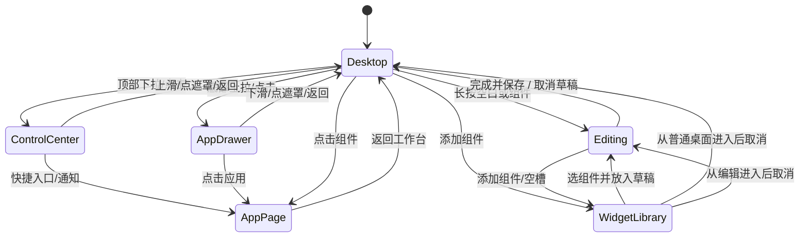

# 03 页面状态与操作流程

## REQ-FLOW-001 状态模型

`ShellState={pageId,overlay,editSession,returnContext}`。pageId=desktop(page0/page1)或app(route)；overlay=None/ControlCenter/AppDrawer/WidgetLibrary/Confirmation；同时最多一个壳层overlay。编辑是桌面的事务状态，不与工业写操作同时进行。业务页自身对话框保留 modal 优先级；壳层手势不能穿透。

图中的Desktop返回实际应恢复进入前的pageId/滚动/所选点位；不能一律清空回第一页。顶栏和底栏在应用页也保留；新抽屉选择应用关闭抽屉后切换内容，不启动第二个 Qt 主进程。

## REQ-FLOW-002 手势分配

采用按下→方向判定→捕获→释放提交；超过12px才锁方向，600ms且位移<12px触发长按。顶部起点y<64且向下超过55px打开控制中心；底部起点y>530且向上超过55px打开抽屉。下拉中心向上55px收起，抽屉向下55px收起。桌面水平滑动超过100px翻页。阈值以1024×600逻辑坐标换算；子控件已捕获的slider、列表、拖拽、输入法、modal优先，不能抢滚动。

顶部点击、所有应用按钮、收起箭头是滑动的等效入口，适合鼠标和单点触摸。Esc按层级：软键盘→确认框→组件库→普通overlay→应用详情→桌面；编辑有未保存改动时显示保存/放弃/继续编辑。F2可进编辑作为维护快捷键，不能成为唯一入口。预览双击进入编辑仅为便利，正式版不依赖双击。

动画为本次补充行为规格，不是静态图现成功能：打开/收起220ms OutCubic，遮罩同步；拖拽复位160ms；低性能配置可禁动画但终态必须一致。不在UI线程sleep。手势未达阈值回弹，不触发底下应用点击。

## REQ-FLOW-010 工作台与组件编辑

首次启动：校验持久布局→合法则加载→不存在采用default-layout.json→损坏保留坏文件并加载默认，提示恢复。组件显示loading后接同一份共享快照；某个服务失败只影响相关卡，不能阻止桌面出现。

点击组件：trend→设备监控并选绑定点位；media→视频页并选文件但不未经用户意图自动开始声音；cloud主体→数据上报、底部“官网绑定”→绑定页；bus→总线页；alarm→告警待确认列表并定位该id；home→家庭设备页并选设备；voice→语音页。首页家庭开关和“按住说话”作为状态/入口，打开详细页后才进行具有明确生命周期的控制。

编辑：复制已提交布局为draft→删除留下空槽→从组件库补位→长按拖动预览落点→释放合法则交换兼容槽，不合法复位→“完成编辑”校验并原子保存成功后回桌面。保存失败停留编辑，旧布局仍有效，可重试保存。取消不落盘，不清除已保存布局。

默认两页，每页固定7槽；page1的trend槽为设备图片，其余保留默认摘要。v1提供增删、同类尺寸槽交换及数据绑定，不做任意像素拉伸或无限画布。slot尺寸能力：large(464×220)为趋势/图片；medium(240×220)为媒体/云；small(224或240×164)为总线/告警/家庭/语音。224与240宽小卡必须各自重新排版文字，外框位置不变。组件库只启用与目标空槽兼容的类型；无指定目标时寻找当前页第一个兼容空槽，无空槽提示“请先移除一个组件”，不能悄悄覆盖已有卡。媒体组可选图片/视频，家庭组可选家庭/语音；二级选择沿用同一面板行式列表，属于需补图的交互态。

变更绑定在编辑态组件配置内完成：点位id/设备id/本地图片或视频文件；绑定列表来自实际数据，不能把硬编码中文名称当主键。若没有数据源，允许保存“未绑定”卡并展示引导。换图片只读文件，加载失败保留标题、空态和重新选择入口。图09是大图片组件正式视觉模板，预览中小“图片组件”仍显示紫色波形的简化分支不可作为生产图片渲染。

## REQ-FLOW-020 控制中心

有线/Wi-Fi快捷块是进入对应网络设置的导航，不是点一下就断网。云端快捷块进入绑定/上报。通知声音：现有代码没有专用系统通知音接口，新增本地设置notifySoundEnabled控制应用自己的通知音；无音频后端时标“声音不可用”，不写成已开启。fixture为忠实保留原图中的“已开启”与灰底组合，runtime按真实状态着色，记录为有意的动态状态差异。

亮度流程：拖动仅更新预览值→释放发一次持久化/硬件应用请求→pending禁止重复提交→核对回读→成功显示实际值。对齐已有“先保存settings再brightness action”的调用链；失败区分设置保存失败、硬件应用失败。不要每移动1px就发一次请求。百分比p转换 `raw=qBound(10,qRound(p*255/100.0),255)`，显示 `qRound(raw*100/255.0)`，因此最小可用亮度约4%，原稿72%对应184；不能发送0关黑屏。收到较旧快照不覆盖用户拖动目标。

通知：读取真实告警+平台/云状态事件；按严重程度、未确认、时间排序；点击行转对应业务页。点击查看全部通知转统一列表或已有告警页加明确筛选；不能点击即确认告警。计数与列表统计口径一致，未知时“--”，不得把没有获取成功当作0。

## REQ-FLOW-030 应用抽屉

打开→读取AppRegistry→按分类和关键词筛选→点击可用应用→AppRouter记录returnContext并切页。无对应能力仍展示入口，标注未配置/不可用，点击展示原因及可行配置入口，不崩溃不启动空页面。固定12入口的fixture保持原文“设计入口”；runtime仅通过真实安装/服务能力消除此标识。

超过12应用时网格区域内部纵向滚动，标题/搜索/分类固定；向下拖动关闭只在内容已到顶部且非输入框/图标按压时启用，防止滚动误关闭。应用表加载失败回退包内已知注册表，不能执行任意注册表shell字符串。返回保留原桌面页和组件状态。

## REQ-FLOW-040 完整业务操作

告警：选有效ID→确认→POST ack→检查成功→刷新告警和snapshot→更新徽标。确认不是消除现场故障；失败保持原状态。

家庭：同步授权设备→取functions→检查fresh/online/writable/pending→操作确认→再次校验revision→发送唯一command_id→显示“结果待确认”并保留最后上报值→刷新只读状态→相符才完成。超时显示未知，不自动重发。

语音：ready且idle/speaking可按下→start_listen→松手或触摸取消→stop_listen→thinking→speaking→idle。切走、失焦、打开全屏覆盖、收到TouchCancel都必须结束本次录音/退出连续对话。服务已断开时显示停止结果未知；接入服务须保留并验证独立最大录音时长/会话退出兜底，不能只靠UI释放事件。连续对话只由用户明确选择开启。

视频：进入页→显式启动worker→等待available→提交偶数物理rect→open(path,volume)→preparing→first_frame→playing；按钮只按实际状态开放。离开详情默认暂停并隐藏视频层；回到桌面显示静态缩略图。打开控制中心/抽屉/组件库前先隐藏硬件视频层，关闭后若仍在媒体页且状态允许再恢复。不要让硬件视频浮在白色抽屉之上。

应用更新：保持UpdatePanel的identity→check→download→install→status流程，确认版本和SHA、维护状态、签名及回滚不变。桌面改版不能自动安装新版本或绕过source_task_id。
