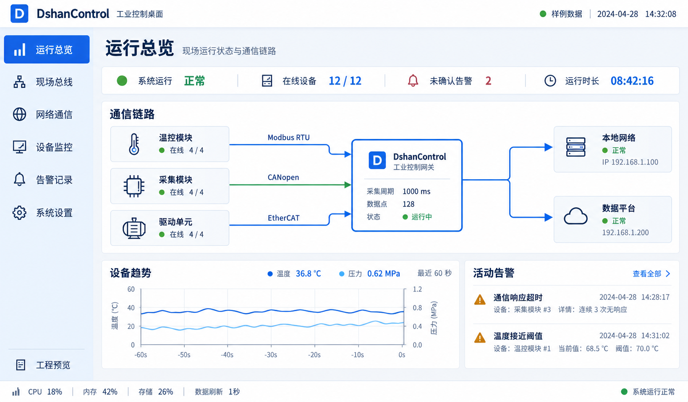
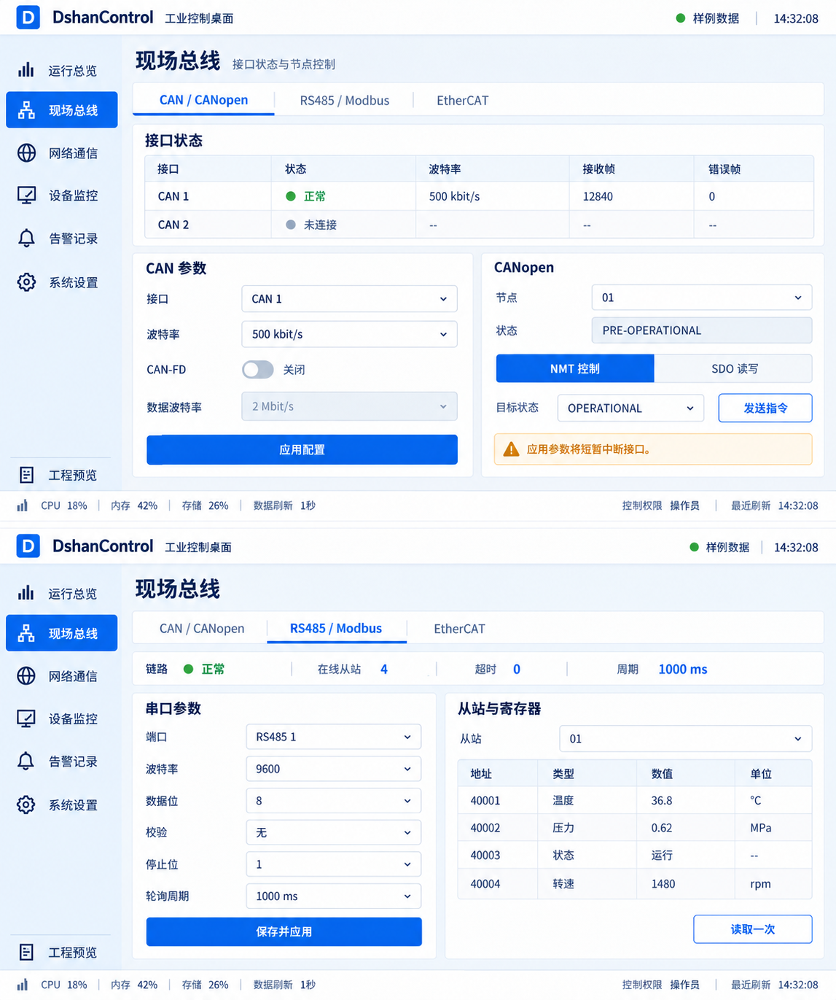
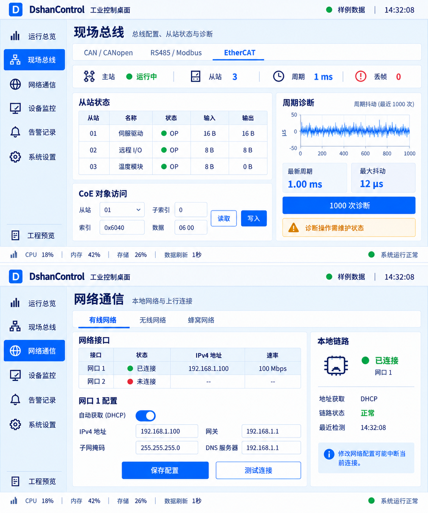
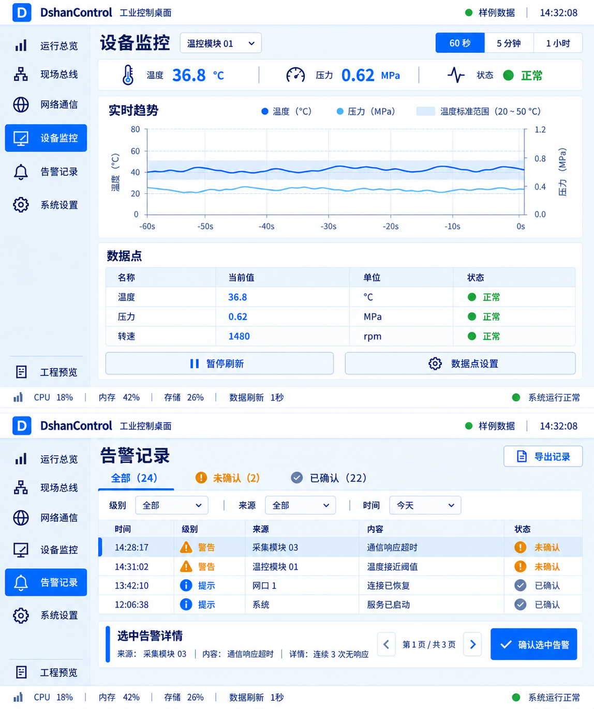
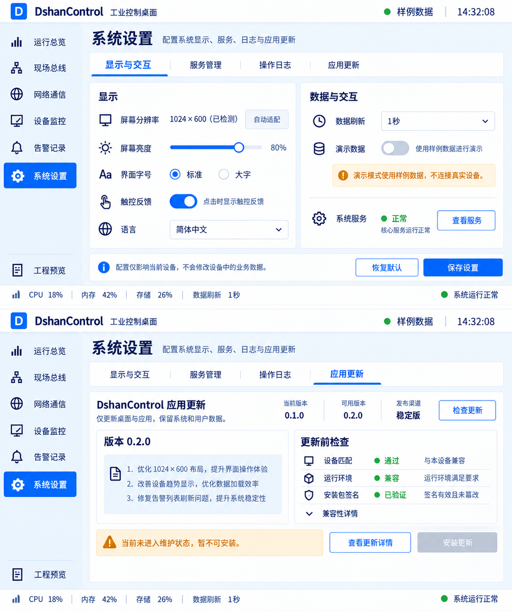

# DshanControl 蓝白工业桌面设计 v1

本轮交付是视觉设计与自适应布局规范，不是已运行的 Qt 新界面截图。
PNG 使用内置 image_gen 生成，提示词保存于 prompts.json；屏幕中设备、读数、
协议连接状态和更新版本均为样例，不构成板级功能验证或实际发布。

## 本轮输入

用户指定 RGB50、1024×600 屏幕，要求全面替换旧界面为蓝白工业风，并自动适配分辨率。
用户本轮称板型为 T113s3；此前工程目标为 T113s4 SD NAND。两者对应关系待用户确认，
本轮只采用明确的屏幕尺寸，不据此修改 BSP、设备树或板型支持声明。

现有 HMI 包含运行总览、现场总线（CAN/CANopen、RS485/Modbus、EtherCAT）、网络、
设备监控、告警和设置。旧实现默认 resize(1024,768)，并存在固定导航宽度与较高图表
最小高度；仅修改窗口大小不足以保证 600 像素高度可用。

## 视觉规范

| 用途 | 颜色 |
| --- | --- |
| 工作面与顶栏 | #FFFFFF |
| 页面背景 | #F2F6FB |
| 导航浅色底 | #EAF2FF |
| 主操作与选中态 | #1260D6 |
| 正文 | #18324F |
| 分隔线 | #D9E3EF |
| 提醒 / 故障 | #B87612 / #CF4555 |

使用清晰的中文无衬线字体；设计参照 Noto Sans CJK，目标镜像需核对实际字体和字宽，
现有文泉驿字体仍可作为回退。常规正文目标 14–16 逻辑像素，标题 22–24；
状态数值使用等宽数字。边角 4–6 像素，无持续动画、发光、玻璃效果或大面积渐变。
图标是识别辅助，保留文字；运行、告警、断线同时使用标记与文字表达。

1024×600 的基本框架：顶栏 52，底部状态栏 24，左导航约 140，内容间距 12–16。
主要触控目标至少 44×44；表格行高至少 40–44，关键操作栏不被页面裁掉。
总览以通信拓扑为中心，避免把所有信息拆成同形状的大数字卡片。

## 全套页面

| 预览 | 页面 | 设计重点 |
| --- | --- | --- |
| [图 1](01-overview.png) | 运行总览 | 通信拓扑、系统概况、趋势、活动告警 |
| [图 2](02-can-modbus.png) | CAN/CANopen、RS485/Modbus | 参数与状态分区，NMT/SDO 用页内标签切换 |
| [图 3](03-ethercat-network.png) | EtherCAT、网络通信 | 从站表、周期诊断、网络接口及连接详情 |
| [图 4](04-monitor-alarms.png) | 设备监控、告警记录 | 趋势与数据点，过滤、详情、确认操作 |
| [图 5](05-settings-updates.png) | 系统设置、应用更新 | 显示/服务/审计分组，升级前置条件可见 |

应用更新页属于新增交互设计，后台已有更新器不代表当前 HMI 已接入该页面。
网络配置、时间跨度选择、记录导出、字号设置等新增控件同样需要逐项核对后端能力。
图中版本号只是样例。正式界面仅按平台能力显示可用通道，未接入或未验证的接口
应显示相应状态，不复制样例中的在线设备和 CAN/EtherCAT 能力。

## 自适应规则

| 可用区域 | 布局行为 |
| --- | --- |
| 1024×600 | 紧凑双栏；表单用页内标签；有限行数表格滚动；关键动作固定可见 |
| 1280×720 及以上 | 扩大图表/表格区域，展开详情；字号适度增加，避免无限拉伸 |
| 800×480 或窄窗口 | 导航折叠为图标并支持展开；内容单栏或分标签；保持触控尺寸 |
| 竖屏 | 切换单栏，拓扑改纵向；不对横屏截图做机械缩放 |

Qt 落地时读取 QScreen 可用几何尺寸，并在 resizeEvent 中重排 QLayout；
使用布局伸缩因子、QSizePolicy、QScrollArea 和按需切换的网格列数。
不使用整张 UI 缩放来凑分辨率，不通过缩小所有字体解决空间不足。
列表与图表可以局部滚动，导航、状态与主要操作仍可达。

RGB50 是硬件接口信息；页面布局主要依据可用宽高、字体度量与设备像素比。
本轮不推断面板物理尺寸、触摸控制器或实际 DPI，也不推断触摸已经启用。

## 状态与操作

- 连接丢失时标明离线/数据过期，不能保留旧值却显示正常。
- 告警选中项与过滤条件保持一致；确认告警不等于故障已恢复。
- 修改总线参数、SDO 写入、停止服务、重启等操作保留明确确认与权限要求。
- 更新页只呈现用户需要的信息：版本、说明、匹配状态、校验结果与维护状态。
  技术标识收进兼容性详情；未进入维护状态时禁用安装。
- 字段错误在就近位置提示。未连接、无数据、能力不支持与正在加载应分别呈现。

## 落地验收边界

生成渲染图用于确认视觉方向，不能证明精确像素排版、字体渲染、触控或性能。
真正验收应捕获 Qt 在 1024×600、1280×720、800×480 和竖屏下的运行截图，
检查控件溢出、文字截断、软键盘、焦点、错误/空态和长文本，然后在目标屏幕上
验证可读性、触摸与刷新性能。未完成前不得把新 UI 标为实板通过。

## 渲染图

### 运行总览

### CAN/CANopen 与 RS485/Modbus

### EtherCAT 与网络通信

### 设备监控与告警

### 系统设置与应用更新

