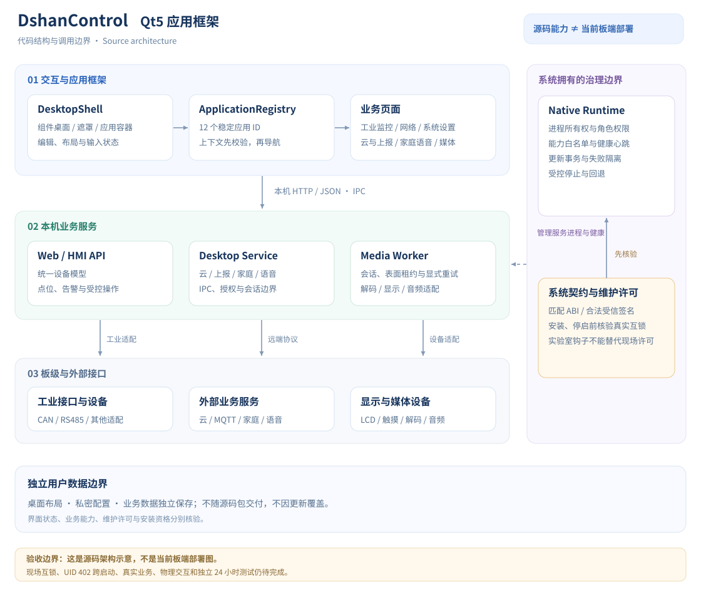

# 定位系统模块与请求链路

按一条实际请求定位源码，确定应修改的模块和应检查的服务。适用于准备扩展页面、接入数据或移植系统的开发者。

## 1. 识别系统分层

| 层次 | 主要模块 | 负责内容 |
| --- | --- | --- |
| 桌面容器 | `DesktopShell`、`ApplicationRegistry` | 工作台、抽屉、应用路由、布局和上下文 |
| 业务界面 | `MainWindow`、Cloud/Family/Media/Update Panel | 表单、状态展示、请求和反馈 |
| 业务后台 | Web API、desktop service | 快照、告警、配置、云/家庭/语音与点位接入 |
| 媒体工作进程 | media worker | 播放会话、解码适配、显示与资源生命周期 |
| 系统运行端 | native runtime | 进程角色、显示/更新服务、身份和健康检查 |
| 板级系统 | SDK、Buildroot、内核和设备树 | 硬件驱动、基础库、启动、存储和系统契约 |

## 2. 按页面定位后台

| 页面或任务 | 请求通道 | 首先检查的源码 |
| --- | --- | --- |
| 总览、网络、现场总线、设置、告警 | loopback HTTP API | `mainwindow.cpp` → `components/web/hmi_api.py` |
| 官网绑定、上报、家庭、语音 | desktop Unix socket | 对应 panel → `desktopclient.cpp` → desktop server/providers |
| 视频播放 | HMI 管理的独立子进程 | `mediapanel.cpp` → `mediasession.cpp` → media worker |
| 应用更新 | 系统更新任务/原生桥接 | `updatepanel.cpp` → 更新桥接 → runtime |
| 布局保存 | 用户数据文件 | `desktopediting.cpp` → `desktoplayout.cpp` |

例如“设置正常但家庭离线”应检查 desktop IPC，而不是首先修改 HTTP API。界面入口能够打开只说明路由成立。

## 3. 跟踪一次数据上报

1. `CloudPanel` 发出 `reporting.configure` 或 `reporting.send`。
2. `DesktopClient` 检查服务 UID，通过本机 socket 发送单行 JSON。
3. `DesktopServer` 校验调用方、协议和字段，再分发方法。
4. provider 校验配置、持久目录或有效点位，提交对应操作。
5. MQTT 代理确认后更新快照，HMI 读取并展示结果。
6. 服务端接收/入库在外部业务系统中另行确认。

调试时分别检查请求、服务返回、异步状态及外部结果。通用 `accepted` 响应不能直接渲染为业务完成。

## 4. 按改动类型选择目录

| 修改任务 | 主要目录 |
| --- | --- |
| 增加组件、路由、输入或布局 | `components/hmi/src/desktop/` |
| 修改业务页面 | `components/hmi/src/` |
| 增加云/家庭/语音/点位适配 | `components/desktop/` |
| 修改 HTTP 接口、采集模型 | `components/web/`、`components/core/` |
| 修改媒体后端 | `components/media/` |
| 修改系统更新、健康或进程角色 | `components/runtime/` |
| 接入 S4 系统 | `boards/t113s4-sdnand/` |
| 增加回归与发布验证 | `tests/`、`scripts/` |

查阅 `docs/design/` 的需求和 `docs/validation/` 的对应证据，避免只依据当前界面推断完整功能合同。

## 5. 确定应用与系统边界

内核、DTB、bootloader、目标 libc/Qt 基础库、公钥和系统服务契约属于系统交付。应用包只包含允许的业务程序与资源，用户配置、布局、数据库和媒体保存在独立数据范围。

新增功能前先确认它需要应用更新、系统更新还是配置变更，分别安排兼容性与恢复验证。

继续[建立开发与测试流程](development.md)。技术依据：[框架说明](../../components/hmi/src/desktop/README.md)、[原生运行端](../../components/runtime/README.md)、[架构资料索引](../architecture/README.md)。
