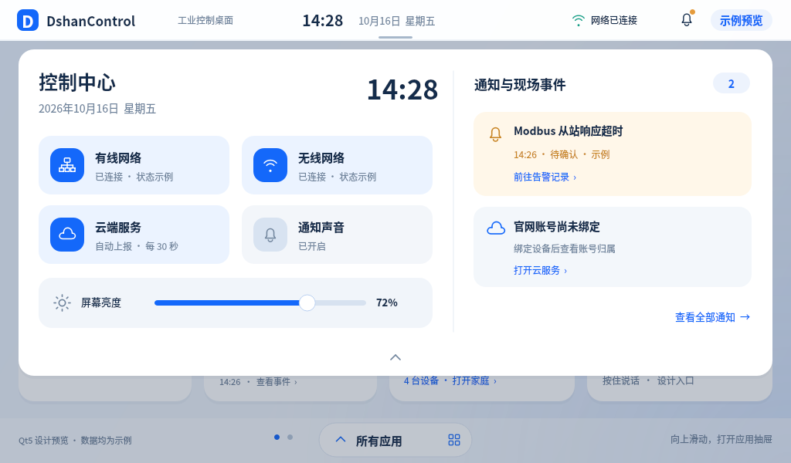
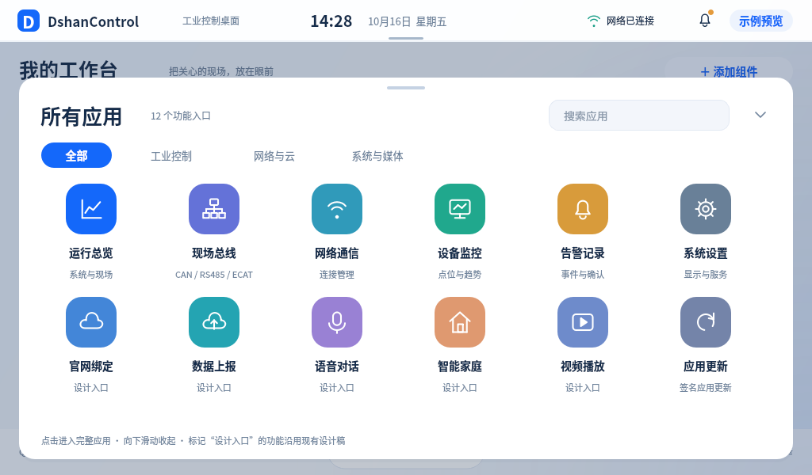
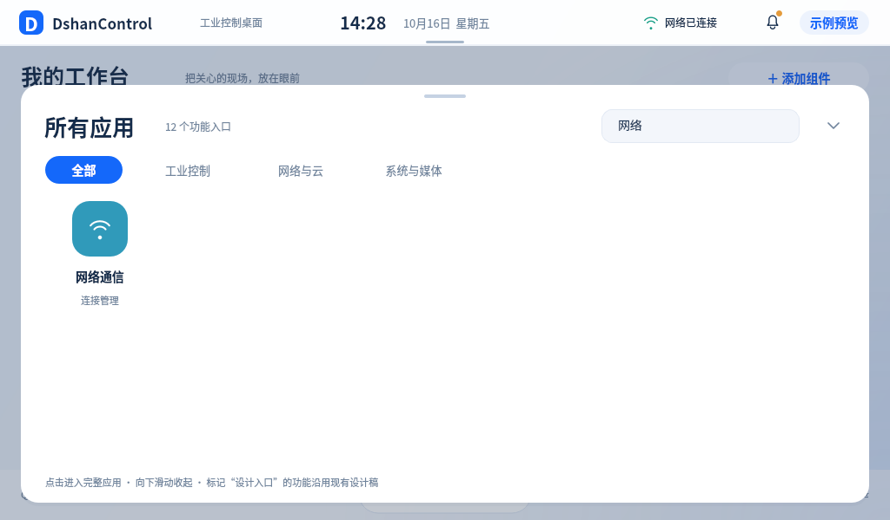

# 打开应用并使用桌面导航

适用于已经打开的 DshanControl 桌面。完成本页后，应能够打开应用、使用搜索、返回工作台，并识别当前操作是否需要后台服务。

## 1. 识别桌面区域

工作台中央显示组件；顶部状态区可打开控制中心；底部入口或上滑操作可打开“全部应用”。应用内使用“返回工作台”回到组件桌面。

控制中心是快捷入口。状态图标、亮度值和读数是否有效，取决于当前服务与设备；示例渲染图仅用于位置说明。

## 2. 打开并退出一个应用

1. 打开“全部应用”。
2. 选择“系统设置”，确认页面标题与所选入口一致。
3. 查看“显示与交互”等子页；本次导航练习无需保存配置。
4. 点击“返回工作台”，确认重新出现工作台组件。

打开控制中心或其他遮罩不会自动结束底层业务。对需要停止的操作，应先在业务页执行结束动作。例如语音使用“结束对话”，视频离开页面时会暂停并隐藏画面。

## 3. 搜索应用

1. 打开抽屉中的搜索框，输入应用名称，例如“视频”。
2. 确认结果名称为“视频播放”，再打开。
3. 没有结果时清空输入，查看分类列表中是否存在对应入口。

搜索范围是已注册的应用入口，不扫描系统中的任意程序。输入法与搜索结果是两个环节：先确认输入文字正确，再判断是否存在匹配入口。

## 4. 按任务选择入口

下表使用当前公开注册清单中的显示名称。

| 应用入口 | 用途 | 操作教程 |
| --- | --- | --- |
| 运行总览 | 查看系统及现场状态摘要 | [读数与趋势](monitoring.md) |
| 现场总线 | CAN、RS485、EtherCAT 参数和动作 | [总线联调](fieldbus.md) |
| 网络通信 | 查看接口，操作已配置的蜂窝连接 | [网络检查](network.md) |
| 设备监控 | 查看数据点和最近趋势 | [读数与趋势](monitoring.md) |
| 告警记录 | 筛选、确认和导出告警 | [告警处理](alarms.md) |
| 系统设置 | 显示、服务、操作日志 | [系统维护](settings.md) |
| 官网绑定 | 查询设备绑定码和账号归属 | [官网绑定](cloud.md) |
| 数据上报 | 配置周期并检查 MQTT 确认 | [数据上报](cloud.md) |
| 智能家庭 | 同步设备并操作可写属性 | [家庭设备](home-voice.md) |
| 语音对话 | 按住说话或连续对话 | [语音操作](home-voice.md) |
| 视频播放 | 选择本地视频并控制播放 | [媒体播放](media.md) |
| 应用更新 | 检查、下载、安装匹配的应用包 | [应用更新](updates.md) |

## 5. 从组件进入业务页

点击趋势组件时，页面应保留绑定点位；点击家庭组件时，应定位绑定设备；点击绑定视频组件时，只选择该文件，仍需在播放页启动播放。

若绑定对象已不存在，先核对原对象和路径，再编辑组件重新绑定。不要将自动选择其他设备或文件当作合理的替代结果。

## 处理空白与不可用状态

| 状态 | 下一步操作 |
| --- | --- |
| 接入服务未连接 | 按[接入服务检查](desktop-service.md)确认 socket、服务身份和进程 |
| 未配置 / 未授权 | 准备相应服务配置或账号授权，再回到页面查询 |
| 缺测 / 过期 | 检查数据源与更新时间，保留原绑定 |
| 按钮灰色 | 阅读本页前提，检查能力、状态、选择项和待处理请求 |

完成一次“抽屉 → 应用 → 工作台”导航后，继续[编辑并保存工作台](widgets.md)。技术依据：[应用注册清单](../../components/hmi/src/desktop/assets/app-registry.json)、[桌面框架](../../components/hmi/src/desktop/README.md)。
