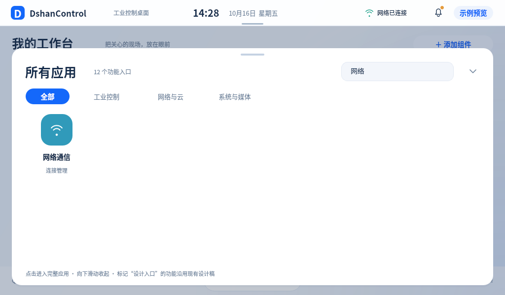
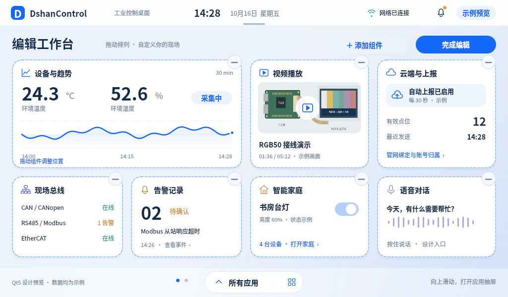
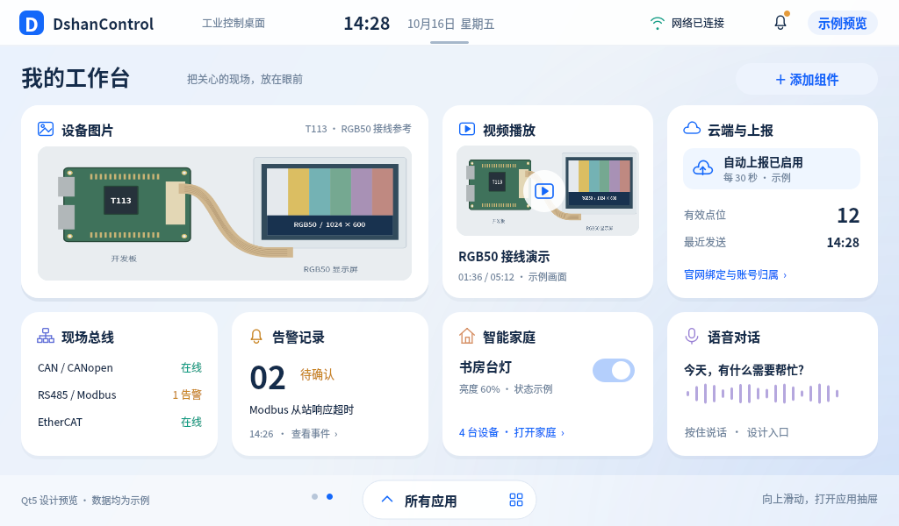

# 对照界面图定位操作入口

本页使用公开仓库中的 Qt5 桌面固定示例渲染，帮助定位操作区域。图中读数、设备名称和在线状态是示例，不代表当前连接状态；具体按钮与业务行为以对应版本实际界面为准。

## 从工作台进入应用

检查顶部状态区、中央组件和底部入口。首次操作按[桌面导航](desktop.md)完成打开抽屉、进入应用和返回。

应用入口由注册清单提供。选择入口后，先查看业务状态，再执行控制或保存。

## 打开快捷控制与搜索

状态信息需要对应后端支持。亮度相关检查见[系统设置](settings.md)。

没有结果时先清空输入，确认名称与注册入口一致。

## 编辑并保存组件

组件设置先“应用到草稿”，再“完成编辑”。完整保存与取消流程见[工作台编辑](widgets.md)。

## 检查图片、展开与宽屏

图片文件属于用户数据，移动或删除后需重新选择路径。

宽屏图用于布局比较，其他分辨率与真实屏幕仍需分别检查。生成方法见[编译与界面审查](development.md)，原始设计来源见[组件桌面设计](../design/component-desktop-v1/README.md)。
