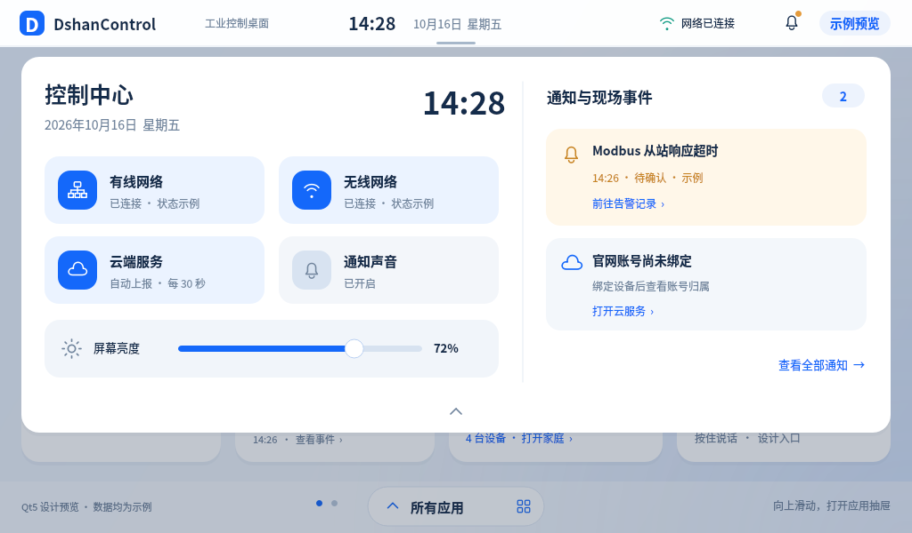
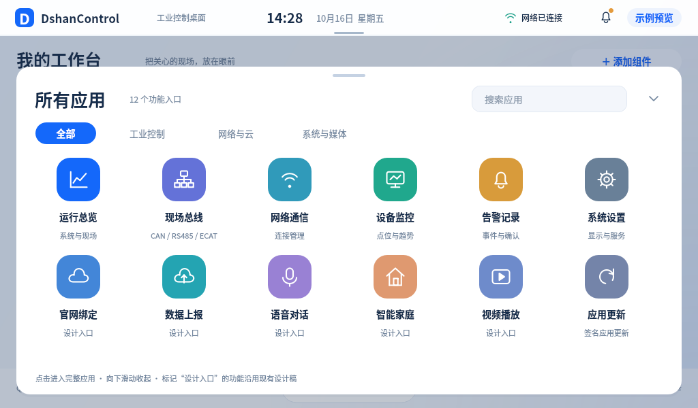
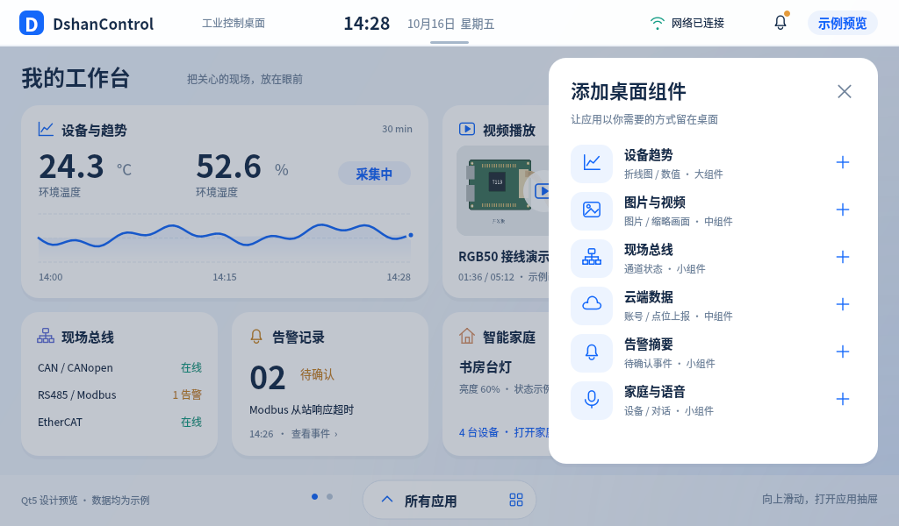
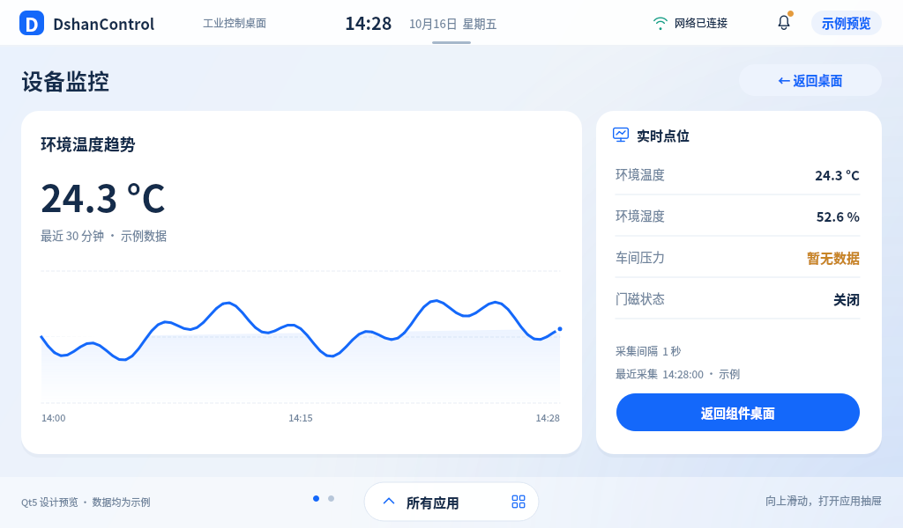
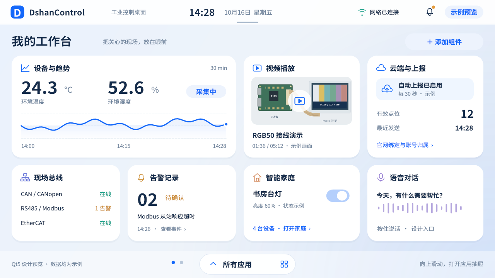

# 查看界面与学习入口

以下图片直接使用公开仓库的 Qt5 桌面主机渲染文件。它们帮助理解布局和操作入口，**固定示例中的数值、在线状态和设备名称不是当前现场数据**。原始批准设计与图片来源保留在 [component-desktop-v1](../design/component-desktop-v1/README.md)。

## 工作台

学习[工作台导航](desktop.md)，再尝试[组件编辑与保存](widgets.md)。

## 控制中心与应用抽屉

控制入口需要真实后端能力。抽屉按注册元数据展示应用，不是任意软件安装器。

## 编辑与组件库

组件设置先应用到草稿，再保存整个布局。

## 搜索、图片与展开组件

图片源文件属于用户数据，移动后需要重新绑定。点位展开仍要检查数据来源和质量。

## 宽屏示例

宽屏示例不等于任意分辨率和任意屏幕已验收。生成方法见[开发教程](development.md)。
