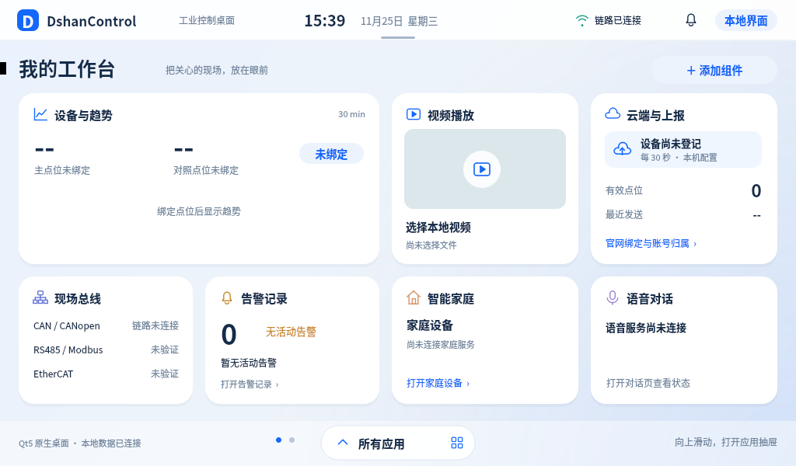

# i.MX6ULL Pro：安装原生服务并完成验收

本章面向 100ASK i.MX6ULL Pro、1024×600 屏幕的开发环境。2026-11-25 的交付采用板端 C/C++、服务端 Go。板端已安装原生 API、总线执行器和生命周期工具；触摸、控制器回环、软件模拟通信、音视频与签名应用升级已在实板验证。没有连接现场从站；官网账号、涂鸦项目授权与 ARM32 语音 SDK 尚未提供，相关业务保持“未配置”，不能把接口测试写成云端联通。

## 1. 先确认交付范围

| 能力 | 当前实现与验证 | 仍需实际环境验证 |
| --- | --- | --- |
| CAN / CANopen | SocketCAN、经典 CAN、NMT、快速/分段 SDO、PDO 映射；实板控制器 loopback 和模拟从站测试通过 | 外部收发器、线缆、终端电阻、真实对象字典；不支持本板 CAN-FD |
| RS485 / Modbus | `ttymxc2` 配置；FC3/FC4 读取、FC6 写入；板端 PTY 真实 RTU 帧、CRC 拒绝、无响应超时通过 | 外部 RS485 电气回环、从站寄存器；保存 `poll_ms` 不会自动启动轮询服务 |
| EtherCAT | SOEM 2.0.0 CLI、扫描、SDO、有限周期诊断；真实网卡无从站错误正确；loopback 数据报模拟通过 | 完整从站发现、CoE、PDO 映射、DC、实时性和实际驱动器 |
| 触摸 | Goodix 识别规则已修复，Qt 已接管输入；用户确认点击和坐标正常 | 长时间触摸与多点操作 |
| 背光 | 桌面 API → root runtime → sysfs，三级设置与读回通过 | 用户对亮度变化的目视验收 |
| 音视频 | WM8960 输出路由、ALSA 传输、FFmpeg 软件视频、共享帧绘制；完整片段与控制操作通过 | 扬声器听感、麦克风拾音、长片稳定性；没有硬件视频解码资格 |
| 官网绑定与上报 | 现有 HTTPS 绑定、TLS MQTT、桌面快照与有效点位校验已接入 | 登记身份、真实服务参数、绑定响应合同、broker 确认及服务端入库 |
| 涂鸦家庭 | Go HTTPS 签名网关，设备/指令白名单、能力校验和持久幂等；模拟 API 测试通过 | 项目 Access ID/Secret、区域、授权设备及真实设备回读 |
| 涂鸦语音 | 桌面 Unix socket 接口保留，ALSA 基础传输通过 | ARM32 hard-float TuyaOpen 音频依赖、设备 UUID/AuthKey、激活、唤醒和实际对话 |
| 应用 OTA | 桌面同一 `check → download → install` 任务链；签名、哈希、健康检查、回退和数据保留通过 | 正式发布源、公钥管理、全型号资格、断电恢复试验 |

实板当前版本为 `0.1.0-imx6ull.20261124.3`，应用源码提交 `f549f80ca9bf0b8c6a5552b2252073d57b85f136`。后续文档和测试依赖提交不改变这个已安装二进制身份。



图为 2026-11-25 从实板 `/dev/fb0` 读取的桌面，非相机照片。未登记的云端与未连接的家庭、语音服务按实际状态显示。

## 2. 理解接口和进程边界

| 入口 | 服务身份 | 用途 |
| --- | --- | --- |
| `127.0.0.1:8080/api/hmi/v1` | C++ API UID 400 | 本地查询、设置及总线动作封装 |
| `/run/dshancontrol/platform.sock` | root runtime | 受限硬件动作、背光、应用升级任务 |
| `/run/dshancontrol/desktop/desktop.sock` | desktop UID 402 | 官网、上报、家庭、语音状态与命令 |
| Qt HMI | UID 401 | 界面、触摸、媒体播放与共享帧绘制 |

总线请求由 Web 通过 Unix socket 转发给 runtime。runtime 检查对端 UID、方法权限、板级通道、参数以及维护互锁，再运行固定的 C++ 执行器 `/usr/bin/dshancontrol-fieldbus-worker`；请求不能指定任意程序或 shell。Web 可调用 `fieldbus.execute`，HMI 不直接获得该方法权限。

硬件控制和 OTA 共用控制锁；系统、应用与用户数据分别管理。实验室维护互锁验证目标板身份、eMMC 布局、独立 `/data` 挂载，以及 CAN、RS485、EtherCAT 未接入现场工作的状态。接入实际设备后必须换成对应设备的安全停机流程。

HTTP 完整合同见[后端接口](../backend-api.md)。桌面服务配置必须包含 `local_api_port: 8080`，避免桌面采样仍访问旧板的 80 端口。

## 3. 编译与测试

构建主机使用 Ubuntu，BSP、工具链与完整系统准备步骤见[板级编译教程](../../boards/imx6ull-pro/README.md)。本轮交叉构建使用 Buildroot 2026.02.1、ARMv7-A hard-float、glibc 2.41。

在源码根目录运行：

```sh
make test-bootstrap
make test
make test-hmi
```

构建与测试工具仍使用 Python；它们不属于板端常驻服务。最新主机整仓回归为 372 项、12 项跳过，包含新增的 720 小时历史查询覆盖；原生 API 的 9 项专项回归也通过。Qt/HMI、Go race 与真实 Qt → HTTPS → Go → 模拟涂鸦测试通过。最终源码 CI 另见验收报告，不把跳过项计入实板通过数量。

应用构建快照必须来自已提交源码；修改主 checkout 不会自动更新旧 external tree。板端依赖包括 Qt5、SQLite、OpenSSL、SOEM、ALSA 和 FFmpeg；Buildroot 应用依赖已移除 Python/Flask/canopen/minimalmodbus。只执行包构建不会更新 `images/` 下的完整固件。本轮通过文件级系统迁移和签名应用 OTA 更新现有板卡，没有重新生成全量启动/rootfs 镜像。增量 Buildroot target 中的旧 Python 文件不会自动消失；板上保留的旧解释器仅用于旧版恢复，不能把本次交付称为“已清除所有 Python 文件的全新固件”。

## 4. 无从站时验证总线

### CAN 控制器回环与 CANopen

平台映射使用 `can0`。本轮实板以控制器 loopback 验证 8 字节 `1122334455667788` 的收发，再通过软件从站响应 SDO 请求，读取 `0x2000` 和写入数值 42 均得到协议应答。测试后恢复 CAN 为 down。

动作示例用于**已确认没有现场设备的实验室板**，由维护程序经现有 HMI HTTP 动作入口提交：

```json
{"action":"can_apply","params":{"interface":"can0","bitrate":500000,"loopback":true},"confirmed":true}
```

`can_send` 和 `canopen_nmt` 返回 `queued:true`，不代表外部从站确认。SDO 只有收到有效响应才返回 `device_acknowledged:true`。原生 API 支持 EDS 导入/绑定与 PDO 映射读取；发送 RPDO 时必须完整提供全部映射变量，并在发送前重新读取映射。映射变化、无效 COB-ID 或变量不完整时拒绝发送。

### Modbus RTU

实际串口映射为 `/dev/ttymxc2`，与控制台串口分开。配置动作接受 `port`、`baudrate`、`unit_id`、`poll_ms`，可选 `parity` 与 `stopbits`；配置原子写入 root 私有状态目录。

```json
{"action":"rs485_config","params":{"port":"/dev/ttymxc2","baudrate":9600,"unit_id":1,"poll_ms":1000,"parity":"N","stopbits":1},"confirmed":true}
```

读取动作 `rs485_read` 使用 `address`、`count`、`function`；写入动作 `rs485_write` 使用 `address`、`value`，默认 FC6。地址为协议零基地址，不直接把手册中的 `40001` 当作 PDU 地址。只有收到并校验响应后才确认设备应答。

在 Linux 主机运行可重复的软件测试：

```sh
.test-venv/bin/python -m unittest discover -s tests -p test_native_fieldbus.py -v
```

测试在 PTY 上发送真实 RTU 帧，验证 FC3/FC6、CRC 和超时。相同测试已在板上使用已安装的执行器跑通。PTY 测试不经过 RS485 收发器；真实串口未连接从站时返回 `No Modbus response` 是预期结果。

### EtherCAT

平台映射使用 `eth1`。SOEM 扫描真实接口未发现从站时返回失败，不伪造设备列表。有限周期诊断的 `count × period_us` 最多 5 秒，执行器有独立超时限制。

软件数据报实验固定使用 Linux `lo`，不会选择物理网卡：

```sh
sudo python3 scripts/ethercat_datagram_lab.py
```

脚本使用真实 `AF_PACKET` 和 EtherType `0x88a4`，交换 5 次 BRD/AL-status 请求与模拟应答，检查 `WKC=1`。板端测得约 2.9–3.7 ms 往返仅为本次模拟观测，不能解释为 EtherCAT 周期性能。此实验不实现完整从站状态机、CoE、PDO 或分布式时钟。

## 5. 背光和音视频

背光动作接受 10–255 的逻辑值，由原生驱动按设备 `max_brightness` 映射。实板请求 64/128/255 时，驱动读回 2/4/8；测试结束恢复原值 8。保存显示设置与实际写背光是两步，验收应检查动作响应和 sysfs 读回。开机由原生生命周期工具通过平台 RPC 恢复保存亮度。

`S97dshan-audio` 初始化 WM8960 左右 PCM 输出混音通道，默认 Speaker 80%、Headphone 70%。此板初始路由关闭会导致 PCM 写入失败；已修复并在重启流程中启用。初始化脚本不启动录音。

媒体 worker 使用 `CONFIG+=software`：FFmpeg 解码本地普通文件，拒绝网络 URL 和软链接，输入尺寸上限 1280×720，输出 512×288 RGB24、10 fps。帧经 Qt 共享内存交给 HMI 绘制，不直接抢占 `/dev/fb0`。

实板 UID 401 下完成测试片全部播放及暂停、seek、恢复、静音、关闭；共享帧长度为 442368 字节。ALSA 播放、采集设备的数据传输均通过，但未凭软件返回值确认扬声器听感或麦克风拾音，未保留录音。

## 6. 官网绑定和云端上报

官网与家庭服务使用独立凭据。板上 `/etc/dshancontrol/desktop.json` 由 UID 402 持有，模式 0600；状态目录为 `/data/dshancontrol/provider-imx6ull`，模式 0700。合并业务配置时保留 `local_api_port: 8080` 和已有状态目录，不覆盖用户布局或数据库。

官网需由设备登记系统提供 `cloud.device_id`、`cloud.pairing_url`、`cloud.secret_file` 及 TLS MQTT 参数，字段结构见[配置参考](configuration.md)。公开官网页面地址不能代替设备登记 API，也不能自行生成一个设备编号假装已登记。

验收顺序：设备身份匹配 → HTTPS 查询绑定码与有效期 → 官网账号绑定 → 再查询归属 → MQTT TLS 连接 → 有效点位上报 → broker 确认 → 服务端查询入库。`accepted`、MQTT PUBACK 和业务入库是不同阶段，界面分别保留状态。

目前缺真实设备登记凭据和服务端联调信息；软件保持未配置状态。完整操作见[官网绑定与上报](cloud.md)。

## 7. 部署 Go 涂鸦家庭网关

本服务运行在 Linux 网关主机，将涂鸦 Cloud API 转为 DshanControl 桌面家庭设备接口。板端继续运行 C++ 桌面服务。项目 Access Secret 保留在网关主机，板上仅配置受限令牌。

### 编译并验证

在 Ubuntu 安装 Go、GCC 和 SQLite 开发文件。仓库 CI 使用 Go 1.26.1。

```sh
sudo apt-get install build-essential libsqlite3-dev
make build-go-gateway
make test-go-gateway
```

生成文件为 `dist/tuya-go/dshancontrol-tuya-gateway`。测试覆盖真实 Qt 桌面经 HTTPS 连接网关、模拟涂鸦上游、签名、令牌刷新、权限、数据类型、并发幂等和重启后的未知命令拒绝。模拟上游通过不表示真实涂鸦账号已授权。

### 准备私有配置

使用独立 Linux 服务账号。配置文件、项目密钥、桌面令牌、TLS 私钥必须为该账号所有且权限为 `0600`；数据库父目录必须为该账号所有且权限为 `0700`。不要将这些文件提交到仓库。

配置结构如下。执行前替换路径、项目 ID 和设备 ID；`region` 必须与涂鸦项目所在区域一致。

```json
{
  "region": "cn",
  "access_id": "REPLACE_PROJECT_ACCESS_ID",
  "access_secret_file": "/var/lib/dshan-tuya/access-secret",
  "desktop_token_file": "/var/lib/dshan-tuya/desktop-token",
  "command_database": "/var/lib/dshan-tuya/commands.db",
  "devices": {"REPLACE_DEVICE_ID": ["switch_led"]},
  "listen": "0.0.0.0:9443",
  "tls_certificate": "/etc/dshan-tuya/server.pem",
  "tls_key": "/var/lib/dshan-tuya/server.key"
}
```

`devices` 同时限制可见设备和可写功能码。空功能码列表允许读取设备，但禁止控制。支持 Boolean、Integer 和 Enum；整数范围、步长和枚举项来自上游功能定义。桌面令牌使用 32～1024 个字母、数字或 `._~-` 字符。TLS 证书必须覆盖桌面配置中的主机名或 IP。

### 保留原命令记录

迁移旧 Python 网关时，先停止旧进程，再备份原数据库及其 WAL 文件，随后将 `command_database` 指向原数据库。Go 网关沿用原 `commands(key,digest,state)` 表，不删除记录。不要通过清空数据库解决重复命令拒绝。

每条命令在访问上游前写入并持久化 `unknown` 记录。响应丢失、进程退出或重启后，相同 `Idempotency-Key` 返回 HTTP 409。上游接受后只返回 `accepted=true,state_confirmed=false`；桌面需等待设备状态回读后才确认完成。

### 启动并配置桌面

使用服务账号执行：

```sh
/opt/dshan-tuya/dshancontrol-tuya-gateway --config /var/lib/dshan-tuya/gateway.json
```

服务要求 HTTPS，不提供明文降级。桌面的私有配置中设置 `home.endpoint`、`home.token_file`；私有 CA 可通过 `https_ca_file` 指定。项目 Access Secret 不复制到板端。

接口保持为：

| 方法与路径 | 请求或结果 |
|---|---|
| `GET /v1/devices` | 已授权设备和真实上报状态 |
| `GET /v1/devices/{id}/functions` | 可控制权限、功能码和类型限制 |
| `POST /v1/devices/{id}/commands` | `{"code":"switch_led","value":true}`；必须提供 `Idempotency-Key` |

所有请求都需 `Authorization: Bearer <受限令牌>`。返回 403 时检查设备/功能授权；409 时检查设备离线、功能缺失或命令已提交；502 表示上游或存储失败，不能据此自动重发控制。

## 8. 接入涂鸦语音

桌面 `voice` 配置需要 Unix socket 路径与实际运行时 UID；客户端校验对端身份，并分别显示配置、激活、录放音和心跳状态。

现有参考工程面向 A133/aarch64。i.MX6ULL 是 ARM32 hard-float，不能直接使用该二进制。仍需匹配架构和 libc 的 TuyaOpen 音频 SDK、`audio_subsys`、MNN 等依赖以及独立设备 UUID/AuthKey，然后实现真实语音 runtime 与桌面 IPC 的连接。ALSA 可用仅证明底层音频传输，不能替代唤醒、识别、合成和对话验收。

## 9. 使用桌面应用 OTA

系统 runtime 保持在 `/usr/bin`，应用按版本安装到 `/data/dshancontrol/application/releases/`，`current` 为原子切换的版本链接。用户配置、布局和数据库位于独立 `/data` 目录，应用包不携带这些数据。

开发环境没有正式发布地址，因此本轮采用显式 `development_mode`、关闭自动安装的本地签名发布源。源目录为 root 私有目录；生产 HTTPS/GitHub 发布规则没有放宽。板上仅部署公钥，签名私钥留在构建主机私有目录，不进入源码、应用包或证据压缩包。

通过 `update.start` 创建检查、下载、安装任务，再使用 `update.status` 查询。安装确认绑定下载任务、版本和包 SHA256，不能用旧页面的确认去安装另一份包。完整合同见[应用更新教程](updates.md)。

本轮从旧 `.2` 升级至原生 `.3`，安装通过 UID 401 的 `check → download → install` 任务链执行。安装包声明 `application_layout: native-cpp-v1`，系统合同显式允许该布局；包内必须包含 API、HMI、桌面和媒体二进制及 Web 资源，并拒绝 `.py/.pyc/.pyo` 文件。

正常应用包 SHA256：

```text
5d5874c570e35a24fb7094beffdcb2b1bfb80bd512f524491dc6e40695e77457
```

坏签名拒绝、sequence 6 故障自动回退及无 Python 启动验证已通过。最终运行正常 sequence 3，防重放计数保留为 6；下一份合法升级必须使用大于 6 的序号。详细实测结果见本轮验收报告。回退不得降低 `high_water`，也不得删除用户数据库或改变 eMMC 分区来绕过失败。空间不足时仅归档已经完成的下载缓存，并核对哈希；任务记录、回退版本和用户数据应保留。

本轮升级资格只覆盖该实测实验室单元，PCB 版本尚未独立核验。应用 OTA 不改变 eMMC 分区，也不等价于系统 A/B 升级或完整固件烧录。

## 10. 复核证据与后续验收

详细板端记录见[原生服务验收报告](../../boards/imx6ull-pro/native-services-validation.md)。后续连接真实设备时，先提供端口、接线、波特率、站号、对象字典/寄存器表及维护要求，再按相同接口验证实物响应。云端与语音则需私有凭据和匹配架构的 SDK；这些输入齐备前，相关功能保持明确的未配置状态。

## 11. 检查触摸输入

在板端串口终端执行：

```sh
cat /proc/bus/input/devices
udevadm info --query=property --name=/dev/input/dshan-touchscreen
p=$(cat /run/dshancontrol/hmi.pid)
ls -l /proc/$p/fd | grep /dev/input
```

实测屏幕的名称为 `goodix-ts`。预期属性包含 `ID_INPUT_TOUCHSCREEN=1`，HMI 已打开对应 event 节点。该 BSP 的驱动还声明了笔按键，默认 `input_id` 会把它识别成 tablet，导致 Qt evdev 自动枚举漏掉触摸屏。

系统规则 `71-dshancontrol-goodix.rules` 按设备名称匹配，清除 tablet 分类并添加 touchscreen 分类及稳定链接 `/dev/input/dshan-touchscreen`，不依赖 event 编号。不要照抄旧注释把触摸固定为 event1；这块板的 event1 是 GPIO 按键。

修复后在屏上依次打开“所有应用”、进入设置、返回工作台，并点击屏幕不同位置。成功判据是界面响应与手指位置一致。2026-11-25 用户已确认“点击和位置都正常”。仅看到设备节点不等于通过实际触摸验收。

## 12. 按顺序完成现场验收

1. 启动后确认 1024×600 桌面可见，Wi-Fi 显示已连接；核对版本 `.3`。
2. 点击“所有应用”，切换页面并返回；检查四角附近按钮的触摸位置。
3. 在显示设置调节背光，再恢复使用值；检查亮度和驱动读回。
4. 选择本地测试视频，检查播放、暂停、拖动进度和静音；人工确认扬声器声音。
5. 无外接从站时，CAN/Modbus/EtherCAT 不应显示真实设备已连接；模拟结果只用于开发验收。
6. 官网、家庭和语音在尚未配置时应明确显示未登记或未连接，不得显示模拟在线设备。
7. 在维护窗口执行普通重启，重新检查触摸、网络、桌面、配置和应用健康。

软件验收通过后，再按实际从站和云平台资料开展真实业务验收。烧录断电、系统 A/B、硬件视频解码、外部 EtherCAT 周期性能不属于本次应用级验证范围。

## 13. 源码仓库与完整镜像交付

2026-11-25 起，主板相关代码在 [i.MX6ULL BSP 仓库](https://github.com/dshanpi/aibsp-imx6ull-pro_linux5.4.47/tree/master/dshancontrol)维护：设备树、Buildroot 配方、udev、平台设备映射、启动和 RAM 维护脚本。桌面、API、业务逻辑、通用原生服务与 Go 涂鸦网关继续在 DshanControl 维护。硬件配方以完整提交和源码 SHA256 引用应用，不复制另一套应用源码。

本次固定关系为：

| 输入 | 固定身份 |
| --- | --- |
| 工厂应用 | `ab981454fd095fb1101bea317ab8dcc33d94897b` |
| 主板集成 | `ad0747ede81ce1c2e8660e0ce1a514e6addee4d5` |
| BSP 基线 | `e00afed02481332d2de44a498518b596651dcdef` |
| 硬件标签 | `imx6ull-pro-integration-v0.1.0-dev.20261125.1` |
| 系统标签 | `system-v0.1.0-dev.20261125.1--imx6ull-pro` |

完整系统通过独立输出构建，目标不安装 Python。镜像中的 `/etc/dshancontrol/build-source.json` 保存应用与硬件身份；发布锁再关联实际压缩/解压镜像哈希，避免把更新后的应用提交冒充原系统来源。

**完整镜像与前面实验室实板环境的配置不同。** 新工厂镜像启动原生 API 和桌面，但不携带实验室单板 CID、Wi-Fi 密码、数据库或签名私钥。特权后台与 OTA 需另外配置设备系统契约、可信公钥、持久存储和真实维护互锁；未完成配置时，依赖该后台的硬件控制和 OTA 不可用。不能把之前的单板 OTA 验收写成该完整镜像的首次升级验收。

系统镜像以 GitHub Draft 管理，访问需具有仓库相应权限；不是公开稳定版，也不进入桌面自动更新源。交付包含 `.img.gz`、应用/BSP/硬件源码、Buildroot 第三方来源和许可证、配置、构建/验证日志、`release-lock.json` 与 `SHA256SUMS`。上传后必须重新下载所有附件，并核对解压镜像和 A/H 来源，不能只核对本地文件。

新整盘镜像采用两分区布局；现有实验室板为三分区布局。整盘覆盖会改写分区表，不能用于宣称保留 p3 的更新。重建与部署前置条件见 [硬件集成说明](https://github.com/dshanpi/aibsp-imx6ull-pro_linux5.4.47/blob/ad0747ede81ce1c2e8660e0ce1a514e6addee4d5/dshancontrol/README.md)。新镜像实板启动、物理断电、外部从站和真实云业务须分别完成后才能提升发布资格。
