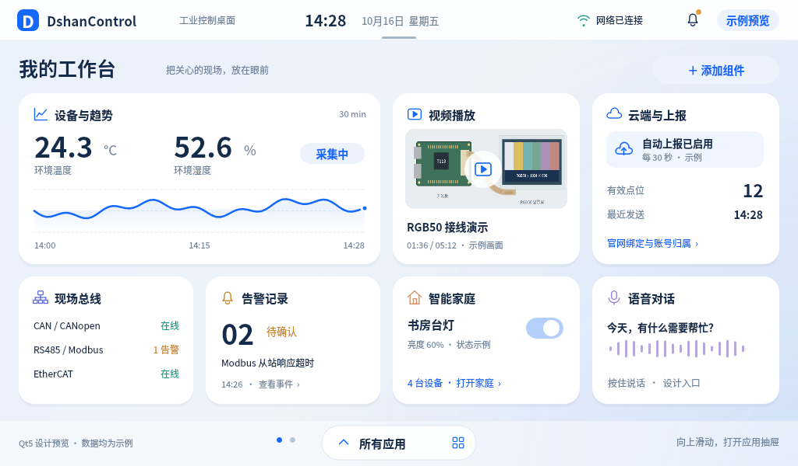

# 认识 DshanControl

DshanControl 是面向带屏工业网关与边缘设备的 **Qt5 组件桌面和应用框架**。你可以把趋势、告警、图片、媒体与业务入口放在工作台，再通过应用抽屉进入现场总线、网络、云、家庭和系统管理页面。

这套教程按“准备 → 操作 → 检查结果 → 处理异常”组织。第一次接触项目，建议先在 Ubuntu 主机完成隔离体验，再阅读目标板集成。

> 图中读数来自固定示例。本站沿用仓库中的主机渲染图，图片不能证明现场设备在线，也不能证明物理屏幕和触摸已经验收。

## 选择你的学习路线

| 你想做什么 | 建议阅读顺序 |
| --- | --- |
| 在电脑上看界面 | [主机快速开始](quickstart.md) → [操作桌面](desktop.md) → [编辑组件](widgets.md) |
| 使用已交付设备 | [硬件与版本](hardware.md) → [网络](network.md) → [趋势与告警](monitoring.md) → [备份](configuration.md) |
| 接入现场协议 | [现场总线](fieldbus.md) → [API 与 IPC](api.md) → 对应硬件的接口资料 |
| 接入云或家庭业务 | [云绑定与上报](cloud.md) → [家庭与语音](home-voice.md) → [后台配置](configuration.md) |
| 修改应用 | [系统架构](architecture.md) → [开发与测试](development.md) → [板卡集成](board-porting.md) |
| 升级或维护 | [应用与系统更新](updates.md) → [故障排查](troubleshooting.md) |

## 先理解三个运行层次

1. **固定示例渲染**：用 `--desktop-render` 生成图片，适合认识界面和做视觉回归，不连接真实业务。
2. **主机窗口运行**：用 `--windowed` 体验交互。未接本机 Web API 或后台 IPC 时，业务显示未连接或不可用。
3. **目标板运行**：依赖匹配的系统、Qt ABI、显示/触摸驱动、进程角色、数据卷和服务契约。主机测试通过不能替代这一层的验收。

## 本教程对应哪个版本

内容核对基线为公开 `main` 的应用提交 **`6c7a5e382fd44c159eeec71b7a19af67498f589e`**。本次文档提交可以更新，应用基线保持单独记录。阅读时不要只凭文件名判断设备版本。

该基线是源码预览；原始 73 项需求记录为 **25 PASS / 48 PARTIAL / 0 RUNNING**。这些是原记录中的状态，不是本次文档验证重新取得的硬件结果。后续开发分支与离线候选未自动并入公开版，参见[版本与证据](versions.md)。

源码预览包、应用更新包、系统镜像是三类不同交付物。本站不把未公开候选镜像列为通用下载，也不要求为阅读教程烧写设备。

## 文档使用约定

- 标有“主机”的命令在 Ubuntu 开发电脑执行；标有“设备”的命令在目标系统执行。
- 示例中的 `/path/to/...` 必须替换成自己的真实路径。设备节点、服务用户和引脚来自本板资料。
- 灰色按钮、缺测与“未配置”是有效状态。不要把缺测当作零，也不要通过演示模式判断真实连接成功。
- 涉及现场控制、停服务或安装的步骤，应在对应设备允许维护时执行。

下一步：[在 Ubuntu 上完成第一次体验](quickstart.md)。原始范围说明见 [PREVIEW](../../PREVIEW.md)。
