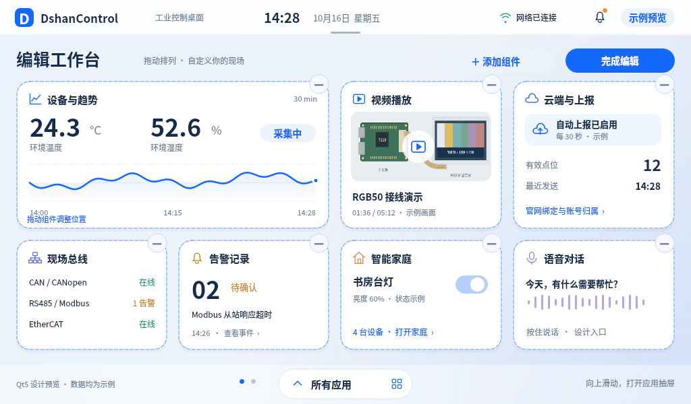
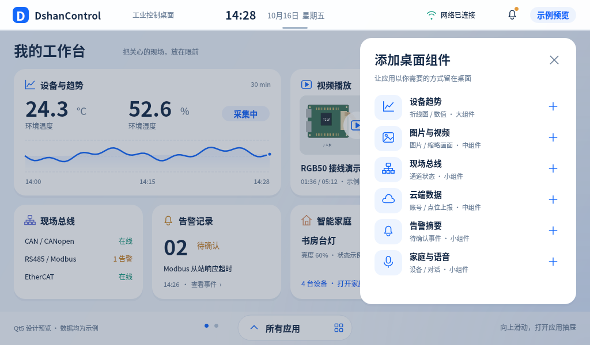

# 编辑组件并保存工作台

**目标：** 完成一次组件调整，并确认保存结果。布局属于用户数据，和应用二进制、云凭据分开保存。

## 编辑与保存是两个阶段

1. 从工作台进入“编辑工作台”。
2. 选择组件，配置其标题和绑定内容；组件配置对话框中的“应用到草稿”只修改本次草稿。
3. 通过组件库添加可用组件，或拖动交换兼容的槽位。
4. 点击“完成编辑”保存整个工作台。
5. 返回工作台，重新进入编辑，核对布局和绑定仍然存在。

退出时有未保存草稿，会出现“保存并离开 / 放弃修改 / 继续编辑”。取消对话框或应用到草稿都不等于最终落盘。

## 布局约束

当前布局格式为 `schema_version=1`，包含 `page0`、`page1` 两页，每页七个固定槽位。它是受约束的组件工作台，不是任意尺寸的自由画布。

| 槽位 | 可放置内容 |
| --- | --- |
| trend | 趋势或图片 |
| media | 视频或图片 |
| cloud | 云组件 |
| bus / alarms / home / voice | 这四类紧凑组件之间的兼容组合 |
| 任意槽位 | 空槽位 |

不兼容的交换会被拒绝，不要手动改 JSON 绕过校验。规则来源：[布局存储](../../components/hmi/src/desktop/desktoplayout.cpp)。

## 配置常见组件

**趋势：** 选择真实设备/点位绑定。先确认点位有来源、单位与质量，再保存。后端离线或点位消失时保留绑定，不用随机曲线填充。

**图片：** 选择本地可读文件，检查预览、裁切/显示效果后应用到草稿，再保存工作台。文件移动或权限变化可能使图片不可读；重新选择真实路径即可排查，不需要删除整个布局。

**视频：** 绑定本地文件后，点击组件进入播放页，再点击播放；绑定动作本身不会自动开启播放。

**家庭：** 绑定后端返回的设备标识。设备暂时不在列表中时绑定会保留；只有在线且有可写能力的属性才适合发送控制。

## 保存失败怎样处理

| 提示 | 检查方式 |
| --- | --- |
| 布局目录不可用或无权限 | 核对数据目录存在、服务用户有权限、卷可写 |
| 正被其他进程保存 | 关闭重复的编辑窗口，等当前保存结束 |
| 已被其他进程修改 | 重新加载最新布局后重新编辑，避免覆盖他人更改 |
| 版本不兼容 | 保留原文件，核对应用和布局 schema；不要强行覆盖 |

保存使用锁和原子写入，并校验加载后文件是否被改动。恢复默认会丢弃未保存草稿，并先尝试把现有文件保留为 `.before-reset`；备份失败时不会继续覆盖。恢复前仍建议按[备份说明](configuration.md)保存独立副本。

依据：[编辑逻辑](../../components/hmi/src/desktop/desktopediting.cpp)、[默认布局](../../components/hmi/src/desktop/assets/default-layout.json)。
