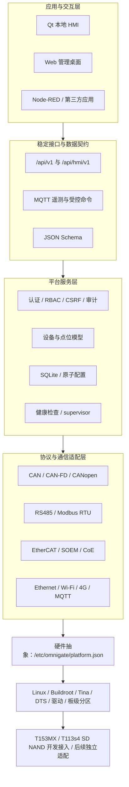

# DshanControl 系统架构

架构遵循单向依赖：应用只访问稳定 API/MQTT 契约，平台服务调用协议适配器，协议适配器
再通过硬件 Manifest 解析板级资源。这样更换 SoC 或 Linux 设备名时，不需要修改业务应用。

## Profile 边界

- Lite：原生 Core、Web、Qt HMI、supervisor、SQLite 和协议适配器，不安装 Node-RED。
- Enhanced：复用相同契约，增加受限 OCI 应用和 Node-RED；容器没有 CAN、串口、GPIO
  或 EtherCAT 原始网卡权限。

上方 SVG 保留历史 T153 架构概览；本文 Mermaid 与
[发布边界](../platform/docs/architecture.md) 描述当前扩展。S4 使用独立 SD NAND 分区
和 ext4 UDISK，不沿用 T153 A/B 分区。两块板须分别验收；T153 短测不覆盖当前 UI 或 S4。
A133/T527/RK3576 为未来目标，RK3568/T536 Enhanced 也仅有主机配置验证。
架构与配置不表示外部从站互操作、24 小时老化或生产安全认证已经通过。
